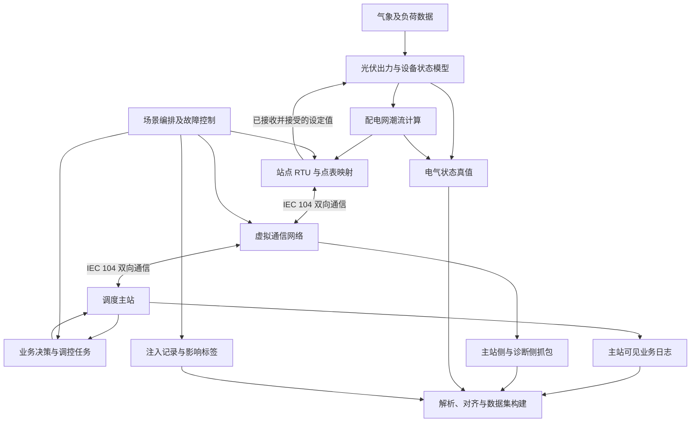
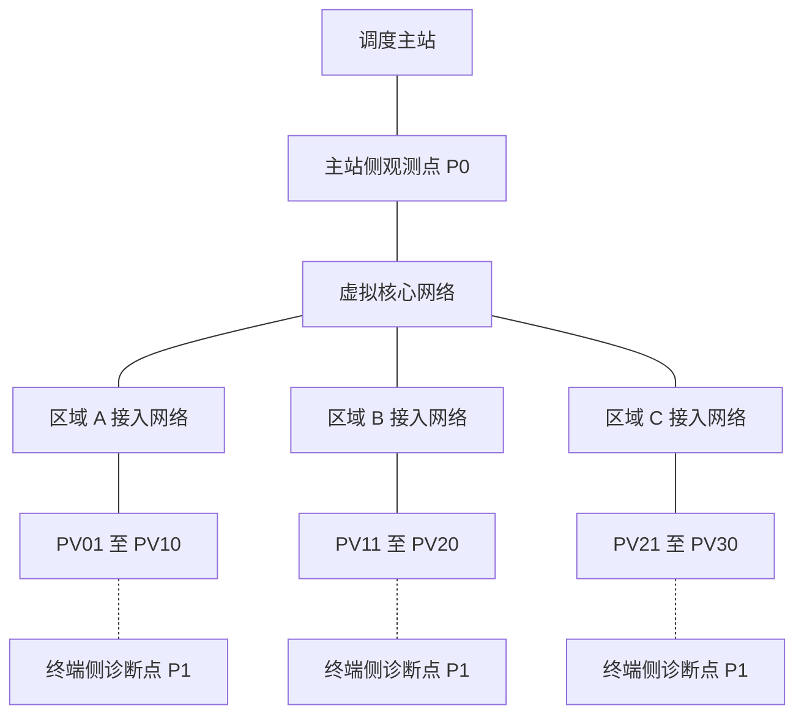
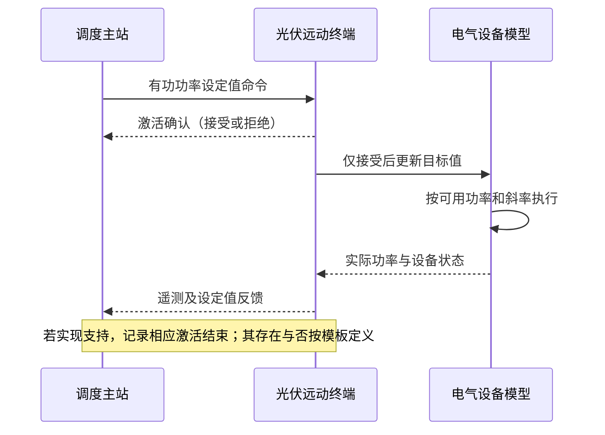
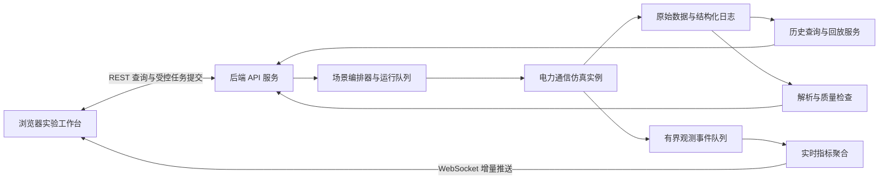
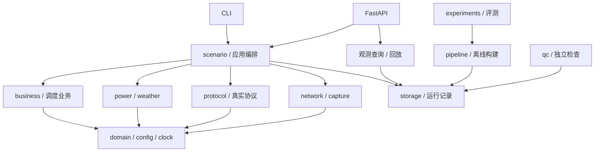

# 分布式光伏电力—通信联合仿真数据集构建方案

> 研究方向：业务约束下的分布式光伏通信异常检测  
> 文档版本：V1.2（实施设计稿，统一工程结构与 Codex 开发规范）  
> 编制日期：2026年11月25日  
> 适用阶段：硕士课题前期数据准备、仿真平台开发与异常检测实验
> 配套文件：仓库根目录 `AGENTS.md`；第 16.2、16.9、21 节为统一工程规范。

## 1. 建设背景与研究目标

分布式光伏并网点数量多、容量和运行方式存在差异，调度主站需要持续获取各并网点的功率、电压及设备状态，并在必要时下发功率调节指令。辐照变化、集中限发、总召唤、终端维护等正常业务可能引起报文频率、传输时序及遥测数值的显著变化。单纯以历史流量分布判断异常，难以区分这些正常变化与非预期的通信中断、业务响应缺失和数据上送异常。

本方案拟建立由光伏运行模型、配电网潮流模型、调度业务模型和真实 IEC 104 协议栈组成的联合仿真环境。由气象、负荷及调度任务驱动正常通信，在隔离环境中施加可控故障，记录实际网络报文、主站可见业务信息、仿真真值和异常影响，形成可以重复生成、扩展与核验的数据集。

### 1.1 需要回答的科研问题

1. 在正常调控导致通信特征偏离常规分布时，引入调控业务上下文能否减少误报？
2. 在报文统计特征相近的情况下，指令—确认—反馈关系及电气运行约束能否提升异常辨识能力？
3. 面对不同站点、通信条件和气象工况，业务约束检测方法是否具有更好的泛化能力？

### 1.2 建设成果

- 一套可配置的多站点分布式光伏电力—通信联合仿真平台；
- 一套浏览器可视化实验工作台，支持实时监测、场景管理、配对回放与数据质量检查；
- 一套明确正常业务与异常影响的事件场景库及可重复执行的场景配置；
- 一套包含原始 PCAP、协议事件、运行数据、业务上下文及分层标签的数据集；
- 一套数据质量检查、划分、特征提取与基线评测程序；
- 数据字典、仿真参数说明、版本清单和数据集说明文档。

### 1.3 研究边界与实施原则

本方案承接课题组提供的《同样是光伏或风电，抓包位置决定了能研究什么》：优先研究并网点远动终端或光伏监控系统与调度主站之间的 IEC 104 通信。假设各模拟并网点具备直接或经等效网关接入远动主站的能力，不假设每台户用逆变器都直接运行 IEC 104。台区内部 Modbus、DL/T 645、DL/T 698.45，以及升压站 IEC 61850 暂不纳入首版。

课题最终题目仍保持“业务约束下的分布式光伏通信异常检测”，IEC 104 是当前实验实现范围。山东地方标准 DB37/T 4792—2024 可作为选取远动链路的工程参考，但不能据此认定河南辉县试点的实际接入方式。辉县实际拓扑、点表、遥测策略和调控时限尚未取得，本方案的各项数值属于拟采用的仿真参数或内部验收目标，并非工程强制限值、现场实测统计或已验证结果。

数据集定位为**真实协议栈驱动的合成数据集**，其中气象数据可来自公开观测或再分析产品；原始通信是实验环境真实生成的网络流量，并不等同于真实生产电网抓包。未获得现场验证前，不宣称数据集代表真实电网的异常发生率或模型具有现场部署效果。

## 2. 总体架构与数据流

### 2.1 联合仿真逻辑



电力侧与通信侧形成闭环：主站根据已经收到的遥测或预先确定的调控计划生成任务；指令经网络到达终端并被终端接受后才改变设备的目标状态；设备按照物理能力及响应速度调整输出，新的运行数据由终端通过协议栈发送回主站。故障可能影响命令交付、反馈时序和主站对实际电气状态的认知。

不得绕过通信链路直接把主站目标写入光伏真值模型，否则通信异常将无法真实影响业务过程。独立于远动通信的本地保护或设备自身状态变化属于电力侧事件，应另行记录。

### 2.2 功能模块与接口

| 模块 | 输入 | 输出 | 拟用工具 |
|---|---|---|---|
| 气象驱动 | 历史辐照、温度、风速、站点位置 | 站点气象时序 | Python、pvlib |
| 光伏设备 | 气象、容量、已接受的设定值、设备状态 | 可用功率、实际 P/Q、运行状态 | pvlib、Python 状态机 |
| 配电网 | 站点注入、负荷、拓扑 | 并网点电压、电流、线路负载率 | pandapower |
| 远动终端 | 电气状态、点表、接收的命令 | IEC 104 报文、终端日志、执行事件 | c104 |
| 调度主站 | 接收的遥测、业务计划 | 总召唤、设定值命令、主站日志 | c104、Python |
| 通信网络 | 主站与终端流量、网络参数 | 实际传输、PCAP、诊断统计 | Linux namespace、NetEm |
| 场景编排 | YAML、随机种子、事件计划 | 运行控制、故障记录、运行清单 | Python |
| 数据处理 | PCAP、日志、真值、点表 | 协议事件、窗口特征、标签、划分清单 | TShark、Polars、Parquet |
| 可视化工作台 | 运行状态、主站观测、经授权的诊断数据及 QC 报告 | 拓扑、趋势、场景配置、历史回放与数据管理 | Vue 3、ECharts、FastAPI |

## 3. 多站点仿真环境设计

### 3.1 仿真规模

| 参数 | V0.1 原型 | V1.0 正式目标 |
|---|---|---|
| 调度主站 | 1 | 1 |
| 通信区域 | 1 | 3 |
| 光伏并网点 | 3 | 30（每区域 10 个） |
| 配电馈线 | 1 条等效馈线 | 3 条径向等效馈线 |
| 光伏容量 | 30、100、300 kW | 20～500 kW，分档配置 |
| 通信规约 | IEC 104 | IEC 104 |
| 电气设备步长 | 1 s | 1 s |
| 潮流计算步长 | 5 s | 5 s，关键事件触发补算 |
| 运行时间 | 30～60 min | 先按 30 个累计场景日生成，视质量扩展 |
| 时间推进 | 实时 1× | 实时 1×，独立环境并行 |

正式环境按虚拟区域划分站点，设置独立的区域接入链路，支持单站点、区域及全局故障范围。电气馈线归属与通信区域归属分别维护，在第一版允许二者部分对应，但不强制相同，以避免模型把电气拓扑和通信拓扑混为一谈。

### 3.2 站点异质性设计

| 属性 | 建议配置 |
|---|---|
| 容量 | 20～50 kW、50～150 kW、150～500 kW，三档各约 10 站 |
| 接入电压 | 0.4 kV 并网点及经等效变压器接入的站点；由模型实际拓扑确定 |
| 组件倾角、朝向 | 按站点配置差异，不在每个时间步随机变化 |
| 逆变器额定视在功率 | 根据容量及功率因数能力配置 |
| 遥测上送周期 | 2、5、10 s 三档，初始相位错开 |
| 遥测变化死区 | 有功容量的 0.5%～2%，由点表配置 |
| 报文组织 | 按设备模板设置单点或多点 ASDU，避免全部站点完全相同 |
| 响应速度 | 容量归一化有功斜率 0.02～0.10 p.u./s，初始测试范围 |
| 通信条件 | 依据区域及站点链路分别配置 |

每个站点的基本属性在一次运行中保持固定，数据生成时随机种子只用于可复现的站点分配、噪声、事件时间等。不同容量和设备模板均需包含正常与异常场景，不能让某种容量或 IP 地址成为异常标签的代理变量。

### 3.3 通信网络结构及抓包位置



P0 是正式检测任务的默认观测位置，可观察主站侧的双向通信。P1 为终端侧诊断抓包点，用于追踪发送、交付和响应过程，不默认提供给检测模型。原型阶段全站双端抓包；批量阶段保留 P0 完整报文，P1 按故障目标和抽检计划保存。用独立网络命名空间、虚拟网卡及虚拟交换网络隔离实验环境，不与生产电网或公共服务连接。

## 4. 电力侧仿真

### 4.1 气象数据准备

| 数据来源 | 用途 | 使用限制 |
|---|---|---|
| ERA5 小时级再分析数据 [1] | 河南地区长期气象背景、季节变化、晴阴工况 | 辐射累计量需按产品定义转换；小时数据不能还原真实秒级云影 |
| Oahu Solar Measurement Grid [2] | 秒级辐照波动和多点云影变化的观测样本 | 夏威夷观测，不代表河南本地气候；仅用于波动模板或独立工况 |
| 课题组光伏实测/已授权数据 | 校准当地出力分布和变化速度 | 待取得；记录采样频率、容量及缺失情况 |

优先采用一组来源明确的河南地区气象数据作为长期背景。将高频观测片段归一化后用于模拟局部云影变化，或直接使用独立高频观测构成压力测试。合成后的辐照序列应满足非负、夜间近零及合理的能量一致性要求，并保存原始来源、日期、采样间隔、插值方式和高频模板编号。不得将插值得到的 1 s 数据称为 1 s 实测数据。

对多站点气象采用区域公共分量与站点局部分量相结合的方式，模拟同一云团经过不同站点时产生的时间偏移、幅度差异和不完全相关性。相关性参数需通过可获得的多点观测校准，缺乏校准时仅作为合成假设。

### 4.2 光伏出力与逆变器模型

使用 pvlib ModelChain [3] 根据辐照、温度、风速、地理位置和组件参数计算可用交流功率 P_avail(t)，亦可在 V0.1 中使用经过边界检查的简化模型。实际有功目标定义为：

$$
P^*(t)=\begin{cases}
\min(P_{avail}(t),P_{set}(t),P_{rated}), & \text{并网且允许发电}\\
0, & \text{停机或解列}
\end{cases}
$$

其中 P_set 为终端实际接受的限发设定值，初始设为额定有功；P_rated 为逆变器额定有功。对正常运行过程考虑执行延迟及有功变化率限制：

$$
P(t+\Delta t)=\operatorname{clip}\left(P(t)+\operatorname{clip}(P^*(t)-P(t),-r_d\Delta t,r_u\Delta t),0,P_{avail}(t+\Delta t)\right).
$$

r_u、r_d 为以 kW/s 表示的变化率。该简化模型允许辐照突然不足或解列造成快速降功率，不以控制斜率限制掩盖物理可用功率下降。实施时明确目标生效时刻、时间步对齐及保护停机优先级。

无功设定按逆变器额定视在功率 S_rated 和运行模式约束：

$$
|Q(t)|\leq\sqrt{\max(0,S_{rated}^2-P(t)^2)}.
$$

第一版采用有功优先；无功优先、Volt-VAR 控制可在扩展版单独配置，不与首版场景混用而不记录。设备真实状态、传感器测量值与终端上送值使用独立变量，以区分物理变化、测量异常及通信反馈异常。

### 4.3 配电网时序仿真

采用 pandapower [4] 搭建简化径向馈线，包含上级电源、配电变压器、线路、负荷及光伏接入节点。原型阶段先完成一条馈线的电压与功率计算；正式阶段扩展为三条等效馈线。基础参数按工程合理性设置并保存来源，线路、变压器参数尚无现场资料时标注“合成”。

每个电气时间步更新 P/Q 和负荷状态，每 5 s 执行一次潮流计算，调控执行、设备解列等关键事件可触发补算。潮流不收敛时记录求解失败标记、保留日志并暂停该样本进入有效数据集；禁止将求解失败简单填充为零并标为通信异常。

| 输出 | 单位 | 数据用途 |
|---|---|---|
| GHI、组件平面辐照度 | W/m² | 气象背景与可用功率估计 |
| 温度、风速 | °C、m/s | 出力模型输入 |
| P_avail、P_set、P_actual | kW | 调控能力及执行真值 |
| Q_actual | kvar | 无功运行状态 |
| 并网点电压 | kV 或 p.u. | 电气状态约束 |
| 并网点电流 | A | 遥测及物理校核 |
| 开关、逆变器状态 | 枚举/布尔 | 业务语义 |
| 馈线反送功率、负载率 | kW、% | 调度任务生成 |

统一功率符号：数据集的光伏发电有功取正，Q 正负定义在数据字典中固定；pandapower 对应元件的内部单位和符号在接口层显式转换。记录各电压字段是线电压还是相电压；三相电流估算仅在平衡近似成立时使用。

## 5. IEC 104 通信与调控业务实现

### 5.1 协议栈及连接

采用 Fraunhofer FIT 相关团队维护的 iec104-python（c104）[5]，以真实 TCP 连接运行主站和 RTU。原型阶段每站独立虚拟地址及服务进程，使用 IEC 104 常用 TCP 2404 端口；正式阶段可以按进程资源需求合并部分终端实例，但保持连接和公共地址可区分。

实现会话建立、启动数据传输、I/S/U 帧处理、遥测周期上送、变化触发上送、总召唤及设定值命令。协议栈负责序列号及链路层确认；业务程序负责测量更新、命令接受条件、实际执行状态和反馈。TCP ACK、IEC 104 S 帧确认及 ASDU 激活确认属于不同层次，数据解析与业务标签必须分别表示。

### 5.2 模拟业务点表（原型模板）

| IOA | 名称 | 方向 | ASDU 类型示例 | 单位 | 上送或控制策略 |
|---|---|---|---|---|---|
| 1001 | 有功功率 P | RTU→主站 | M_ME_NC_1 (13) | kW | 周期＋死区变化 |
| 1002 | 无功功率 Q | RTU→主站 | M_ME_NC_1 (13) | kvar | 周期＋死区变化 |
| 1003 | 并网点线电压 | RTU→主站 | M_ME_NC_1 (13) | kV | 周期＋死区变化 |
| 1004 | 并网点电流 | RTU→主站 | M_ME_NC_1 (13) | A | 周期上送 |
| 1005 | 辐照度（可选） | RTU→主站 | M_ME_NC_1 (13) | W/m² | 按点表配置 |
| 1006 | 已接受有功设定值 | RTU→主站 | M_ME_NC_1 (13) | kW | 事件触发及召唤 |
| 1007 | 已接受无功设定值 | RTU→主站 | M_ME_NC_1 (13) | kvar | 事件触发及召唤 |
| 2001 | 逆变器运行状态 | RTU→主站 | M_SP_NA_1 (1) | bool | 变化触发 |
| 2002 | 并网开关状态 | RTU→主站 | M_DP_NA_1 (3) | enum | 变化触发 |
| 2003 | 设备故障状态 | RTU→主站 | M_SP_NA_1 (1) | bool | 变化触发 |
| 3001 | 有功设定值命令 | 主站→RTU | C_SE_NC_1 (50) | kW | 直接执行模板 |
| 3002 | 无功设定值命令 | 主站→RTU | C_SE_NC_1 (50) | kvar | 直接执行模板，扩展 |

公共地址（CA）原型设为站点编号 1～3，正式环境为 1～30；IOA 可以在不同 CA 下复用。点表主键为 `(device_profile, common_address, ioa)`，同时关联数据类型、工程单位、死区、周期和上下限。带时标遥测可在扩展模板采用 M_ME_TF_1，是否支持以实际协议库版本测试为准。

上述 IOA 和报文配置为实验点表，不是现场配置。V0.1 只要求有功、无功、电压、运行状态、总召唤和有功设定值闭环；其余点逐步补齐。不得将模拟私有点表直接声称为标准规定。

### 5.3 核心正常业务流程

#### （1）周期性遥测与变化上送

设备按电气时间步更新测量点；终端根据 `report_ms` 或等效调度机制发送周期数据，并依据死区和最小事件间隔发送变化数据。周期上送与变化上送分别记录触发原因。是否发送多点 ASDU 由设备模板决定，需依据抓包实测确认。

#### （2）总召唤与会话恢复

主站发送总召唤命令 C_IC_NA_1（100），终端按实现返回激活确认、召唤数据和结束信息。总召唤可能造成短时流量集中，启动时和恢复后的总召唤均属于候选正常业务。启动后何时执行召唤、重连后是否重新召唤，按设备模板与主站策略配置。

#### （3）有功功率调节（首版重点）



激活确认说明命令被接受或拒绝，不直接证明实际功率已经达到目标。激活结束的语义及是否发送应依具体设备模板和协议实现核验。实际功率反馈是独立业务事件，结合可用功率、执行时间和设备状态判断执行是否合理。

#### （4）多站点集中调控

主站依据预设计划或其已接收的馈线相关监测量生成区域限发任务。按照容量比例或当前可用功率估计分配各站点目标，在不同站点能力范围内调整；任务中记录目标区域、站点集合、下发顺序和时间。站点之间允许正常响应延迟、拒绝及可用功率差异，不设定全体站点必须同步变化。

#### （5）维护及主备切换（扩展）

第一版只实现经授权的计划内终端维护、会话关闭与恢复。真实主备切换需要明确双路径、切换触发和业务恢复机制，待 V0.4 之后独立实现；不能把简单断开并重连称为已实现主备路径切换。

### 5.4 协议与业务计时建议

| 参数 | 初始建议 | 说明 |
|---|---|---|
| 协议库调度 tick | 100 ms | 上送周期须满足当前库约束，版本固定 |
| 周期遥测 | 2/5/10 s | 站点异质性 |
| 变化上送最小间隔 | 1 s | 业务模型限制，不是协议强制值 |
| 总召唤周期 | 15～60 min | 另含启动、恢复和按需召唤 |
| 正常命令确认时间 | 参考 0.1～1 s 的原型测试 | 由实际 RTT、处理时间共同决定 |
| 命令确认业务期限 | 初始 3 s | 按场景及站点模板配置、后续校准 |
| 功率执行评估期限 | 初始 10～60 s | 随目标变化幅度和斜率动态计算 |
| 协议 t0/t1/t2/t3、k/w | 先用选定协议栈默认值 | 记录实际值，校验 t2 与 t1 关系及库实现 |

期限参数仅用于可控实验。协议计时器、应用业务超时和功率执行时间分别管理，不能使用同一个固定阈值描述全部异常。

## 6. 通信网络与时间同步

### 6.1 正常网络参数

| 网络模板 | 单向基础时延 | 抖动量级 | 正常背景丢包率 | 用途 |
|---|---:|---:|---:|---|
| L1 | 5～20 ms | 1～5 ms | 0～0.05% | 稳定接入 |
| L2 | 20～60 ms | 5～15 ms | 0～0.1% | 一般接入 |
| L3 | 60～150 ms | 10～30 ms | 0～0.3% | 波动接入压力场景 |

采用 Linux NetEm [6] 模拟网络条件；双向参数分别记录。以上是覆盖不同通信条件的合成模板，不能解释为某一种专网或公网的实测性能。应在每个模板中同时生成正常和异常数据；通过 PCAP 和独立诊断测量实际 RTT、重传、业务交付结果，确认配置确实生效。

网络层随机丢包可能被 TCP 重传掩盖。只有在检测目标定义为传输层退化且有实际观测证据，或者业务交付确实受影响时，才标记对应的检测标签；不能将每一个丢失的 IP 包都解释为 IEC 104 遥测缺失。

### 6.2 时间推进与同步机制

真实协议栈运行于操作系统时钟，TCP 重传及 IEC 104 超时不会自动按电气仿真时间缩放。首版采用 1× 实时联合仿真，不通过压缩 PCAP 时间戳伪造长时间运行。

- `ts_capture_utc_ns`：PCAP 原始观测时间，UTC 纳秒字段保存原始精度；
- `ts_mono_ns`：同一宿主机内部的单调时钟，用于事件调度和耗时统计；
- `sim_elapsed_ms`：场景开始后的逻辑时间；
- `source_weather_ts`：气象数据原始时间，与回放开始时间分开；
- `ts_device`：报文携带时标（如果存在），不使用抓包时间替代；
- `available_at`：某条业务上下文真正进入主站可见范围的时间。

运行开始记录逻辑时间零点与系统时钟的对应关系。电气模型按单调时钟驱动，使用共享时钟或明确跨进程映射。若使用多宿主机，另需校准时钟偏差，并将不确定性写入运行清单。离线处理按 `available_at` 做因果对齐；对迟到数据保留源时间与到达时间，不将其回填至此前模型输入。

批量数据优先采用多个隔离仿真实例并行，每个实例维持自身的真实计时关系。只有经对照验证协议时序等价后，才考虑采用更快的离散事件网络模拟作为独立数据模式；该模式与真实协议栈生成的 PCAP 不混称。

## 7. 正常运行场景库

正常样本应覆盖平稳运行及具有强扰动的合法业务。其标签依据已知业务意图、设备状态与实际通信服务结果确定，不能依据流量是否超出历史均值确定。

| ID | 场景 | 仿真条件与业务行为 | 主要观测结果 | 版本 |
|---|---|---|---|---|
| N01 | 平稳日间运行 | 正常辐照、周期遥测 | 稳定连接和遥测 | 首版 |
| N02 | 夜间与日出日落 | 可用功率近零或逐步改变 | 功率变化与正常状态切换 | 首版 |
| N03 | 局部云影 | 秒级辐照快速变化，无调控任务 | 功率变化、变化上送增加（依策略） | 首版 |
| N04 | 单站限发 | 目标低于当前可用功率 | 命令、确认及功率反馈 | 首版 |
| N05 | 多站集中限发 | 区域内部分站点接受目标 | 多连接短时业务变化 | 首版 |
| N06 | 解除限发 | 提高目标，受可用功率限制 | 功率恢复或维持受限 | 首版 |
| N07 | 可用功率不足 | 阴天仍接收合法目标 | 功率未达到目标但反馈合理 | 首版 |
| N08 | 总召唤 | 计划或主站按需发起 | 短时集中数据上送 | 首版 |
| N09 | 合法命令拒绝 | 不满足设备运行或权限条件 | 否定确认、设备状态不变 | 首版 |
| N10 | 计划维护 | 授权时段内终端断开并恢复 | 连接变化、重新召唤 | 首版 |
| N11 | 正常保护动作 | 电力侧真实状态触发设备保护 | 状态及告警集中上送 | 扩展 |
| N12 | 正常主备切换 | 已建模双路径按计划切换 | 短时扰动及业务恢复 | 扩展 |
| N13 | 无功调节 | 合法 Q 目标及容量约束 | Q 与电压变化 | 扩展 |

计划维护和保护动作并不天然意味着全过程均正常。若维护超出授权时间或恢复后遥测未恢复，应将超出约束的部分另行标记。合法拒绝与物理可用功率不足属于正常边界情况，应当独立采样，避免模型将所有“功率未达到目标”误判为通信异常。

## 8. 异常场景库与判定机制

### 8.1 异常定义及研究范围

异常指在给定运行状态和已知业务条件下，通信服务、协议交互或数据交付过程偏离预设的合理约束。第一版以通信故障和业务交互异常为主，不以网络攻击识别为唯一研究任务。单纯的设备物理故障、正常辐照变化不直接标为通信异常；若电气设备故障导致通信交付异常，两类事件分别记录。

场景注入记录仅表明实验施加了某种条件，不直接代替业务异常标签。每个异常应同时记录注入是否成功、通信侧可观察证据、业务实际影响及恢复过程。

### 8.2 首版异常类别及参数

| ID | 类别 | 仿真实验条件 | 低/中/高强度候选 | 判定证据 | 优先级 |
|---|---|---|---|---|---|
| A01 | 非计划通信中断 | 独立实验链路暂时不可用 | 5/20/60 s | 非授权断开或业务可用性违约 | P0 |
| A02 | 时延异常 | 实验链路延迟显著上升 | 0.2/1/3 s 附加单向延迟 | 实测时延与业务期限违约 | P0 |
| A03 | 传输退化 | 实验链路丢包、重传增加 | 1/5/15% 配置丢包率 | 重传与实际交付结果 | P1 |
| A04 | 遥测上送缺失 | 模拟终端采集/上送功能异常 | 2/5/12 个期望周期 | 应上送的有效数据未按期到达 | P0 |
| A05 | 业务响应超时 | 模拟终端业务处理异常 | 额外 2/5/15 s | 已发送的有效命令超出确认期限 | P0 |
| A06 | 调控反馈缺失 | 模拟终端反馈功能异常 | 10/30/60 s | 命令接受后未获得规定的有效反馈 | P0 |
| A07 | 数据冻结 | 模拟采集缓冲区未更新 | 10/30/120 s | 独立状态证据与过期测量不一致 | P1 |
| A08 | 会话恢复失败 | 模拟终端恢复过程不完整 | 1/3/5 个恢复观察周期 | 连接恢复但业务数据未恢复 | P0 |
| A09 | 遥测值不一致 | 模拟测量/报告模块故障 | 容量的 5/15/30% 偏差 | 独立测量或可信物理约束支持 | P1 |

P0 为首批开发内容（6 类），P1 在原型闭环稳定后增加。强度是注入参数，不是检测难度或严重度的真值；在某些组合中可能未产生业务影响。各类事件可发生在单站、同区域多个站或不同区域，影响范围以独立字段表示，不把“区域异常”与“时延异常”等机制混为互斥分类。

所有故障在隔离网络及自建模拟终端内实现，优先通过受控仿真参数与组件故障模式产生，不修改真实生产报文，不接触现场调度系统，不进行面向外部系统的攻击实验。首版不要求恶意报文构造或攻击复现。

### 8.3 注入事件、可观测影响和恢复

每次事件划分以下阶段：预热、故障作用、业务影响、恢复观察、运行结束。注入起止时间、实际异常出现时间与恢复完成时间独立记录。例：延迟施加于 12:00:00，预期确认在 12:00:03 截止，若截至该时刻仍未收到有效确认，则业务超时起点为 12:00:03；后续收到迟到确认时仍保留原超时记录。恢复后应检查遥测新鲜度与待处理命令状态。

首版以单故障事件为主，避免无法归因；组合故障放入独立压力测试，不与训练集的单故障事件混合统计。若注入未造成业务违约，则 `service_label` 为正常或待判定，但注入真值仍为已施加；注入执行失败则整次运行需标注无效或重新生成。

## 9. 正常—异常配对场景（数据集核心设计）

若模型只凭流量阈值即可完全区分所有样本，难以证明业务约束的必要性。配对场景共享气象背景、站点配置、网络基线、随机种子及初始状态，尽可能控制非目标因素，同时改变业务意图、交付结果或故障条件。

| 配对 ID | 正常成员 | 异常成员 | 需要控制的通信表象 | 主要业务判据 |
|---|---|---|---|---|
| P01 | 合法总召唤或集中调控 | 非预期重复上送（扩展场景） | 包数、持续时间、方向分布 | 请求与上送关系 |
| P02 | 云影造成真实功率下降 | 模拟遥测值偏差 | 功率下降幅度及变化速度 | 独立气象、可信状态 |
| P03 | 授权维护期间断开 | 非计划通信中断 | 断开时长、重连行为 | 已知维护计划、恢复期限 |
| P04 | 可用功率不足，执行合理 | 已接受命令后反馈功能异常 | 功率未达到设定值 | 有效反馈、新鲜度、可用功率 |
| P05 | 夜间稳定或低波动遥测 | 数据冻结 | 连续相同值 | 运行工况及独立状态 |
| P06 | 合理命令拒绝或响应波动 | 无有效确认的业务超时 | 命令交互短时异常表象 | 确认结果与期限 |

其中 P01 的非预期上送和 P02/P05 的测量一致性场景依赖扩展模块或独立观测条件，未完成前不计入首版交付。P03、P04、P06 优先实现。

### 9.1 两类配对方式

- **同业务反事实配对**：同一调控任务运行两次，分别保持正常网络/终端和施加受控故障，用于核验故障因果影响。
- **相似表象跨业务配对**：选择正常业务与异常业务中流量统计相近的事件，检验业务上下文是否提供额外判别信息。

每组共享 `pair_id`、`source_group_id`，各自具有不同 `run_id`。两成员及其衍生窗口必须划入同一数据分区。使用预先固定的特征（双向包数、字节数、事件持续时间、到达间隔统计）比较相似度，并报告匹配成功比例及未匹配原因。不得事后删改原始报文来人为制造相似性，也不能依据待评测模型的输出筛选测试样本。

部分跨业务配对需要主站可用的维护计划或独立气象信息。如果在指定观测模式下两种状态确实不可区分，应报告不可辨识边界，不将其简单归咎于模型性能不足。

## 10. 业务约束与可观测性设计

### 10.1 候选业务约束

| 约束 | 表达方式 | 所需信息 | 研究定位 |
|---|---|---|---|
| C1 协议与点表语义 | 类型、传送原因、方向、CA/IOA 及会话状态合理性 | P0 报文、已知点表 | 基础规则及基线 |
| C2 调控交互时序 | 命令→有效确认→反馈的条件化时序 | P0 报文、主站事件 | 核心 |
| C3 电气运行一致性 | 可用功率、设定值、状态及合理响应范围 | 独立气象/可信测量、主站信息 | 条件性核心 |
| C4 多站点协同 | 任务目标集合、站点差异及响应分布 | 区域任务与多站通信 | 核心扩展 |
| C5 维护和恢复 | 授权时间、恢复过程、数据新鲜度 | 主站运维计划、P0 报文 | 场景补充 |

例如对已发送的有效命令，定义确认延迟 `d_ack = t_ack - t_send`；超过该命令所属模板的确认期限且未收到有效确认，产生时序违约。对功率执行残差，只在设备状态、目标语义、可用功率估计及等待时间满足评估前提后计算。模型宜采用条件化或软约束，避免把设备差异、天气不确定性和采样间隔当作故障。

### 10.2 检测信息分级

| 信息模式 | 允许的在线输入 | 禁止作为输入的内容 |
|---|---|---|
| M0 流量基线 | P0 的 TCP/IP 包与窗口统计 | 全部注入信息、终端真值 |
| M1 协议感知 | M0 + P0 应用层事件与点表 | P1、未来日志、内部执行真值 |
| M2 业务感知（主实验） | M1 + 当前已知调控任务、维护计划、主站已收到的响应 | 后验执行结果、异常调度表、真值 |
| M3 增强业务感知 | M2 + 独立且实际可用的气象/可信状态来源 | 仿真 P_actual 真值、注入记录 |
| Oracle 诊断 | 双端抓包和完整仿真真值 | 仅作标签核验或理论上界，不作部署性能 |

如果辐照度和功率均来自同一远动链路，不能假定辐照数据天然可信、独立。M3 所需独立数据源必须在仿真中明确生成观测误差、采样频率和可用时间；若实际场景无法提供该类数据，则 C3 仅作为扩展研究，不作为主要结论的必需条件。

## 11. 数据采集与存储规范

### 11.1 数据集目录

```text
pvcomm_dataset_v1/
├── README.md
├── dataset_card.md
├── metadata/
│   ├── stations.csv
│   ├── topology.json
│   ├── point_table.csv
│   ├── device_profiles.yaml
│   └── data_dictionary.csv
├── runs/<run_id>/
│   ├── scenario.yaml
│   ├── manifest.json
│   ├── raw/pcap/primary_*.pcap
│   ├── raw/pcap/diagnostic_*.pcap
│   ├── observed/master_events.parquet
│   ├── observed/weather_observations.parquet
│   ├── parsed/packets.parquet
│   ├── parsed/iec104_apdu.parquet
│   ├── parsed/iec104_objects.parquet
│   ├── truth/electrical_state.parquet
│   ├── truth/terminal_events.parquet
│   ├── truth/fault_events.parquet
│   ├── truth/dispatch_execution.parquet
│   ├── labels/event_labels.parquet
│   └── qc/report.json
├── features/<feature_version>/
├── splits/<split_version>.json
└── checksums.sha256
```

`observed/`、`parsed/` 与 `truth/`、`labels/` 分开存储，训练加载器采用输入字段白名单，避免不经意引入仿真真值。PCAP 按运行和固定文件大小或时长滚动保存，保留接口编号、抓包方向及完整包长度。

### 11.2 关键数据字典

所有表至少包含 `run_id`；站点相关表包含 `station_id`。时间字段采用 UTC，Parquet 时间类型与整数精度在 schema 中固定；可空字段用 null，不以 0 同时表示缺失与真实零值。

**(a) stations.csv / point_table.csv**

| 字段 | 类型 | 含义 |
|---|---|---|
| station_id, region_id, feeder_id | string | 站点、通信区域及电气馈线 |
| device_profile | string | 终端及业务模板 |
| capacity_kw, rated_kva | float | 额定功率及视在功率 |
| common_address, ioa, type_id | int | 点表地址及类型 |
| point_name, unit, direction | string | 点语义、单位、方向 |
| report_period_ms, deadband | int/float | 上送策略 |

**(b) packets.parquet / iec104_apdu.parquet / iec104_objects.parquet**

| 字段 | 类型 | 含义 |
|---|---|---|
| capture_id, packet_index | string/int | 原始抓包文件与帧索引 |
| ts_capture_utc_ns, available_at | int64 | 抓包及可见时间 |
| flow_id, connection_epoch | string/int | TCP 会话及连接轮次 |
| src_ip, dst_ip, src_port, dst_port | string/int | 传输地址信息 |
| direction, tcp_flags | string | 方向与 TCP 标志 |
| packet_len, tcp_payload_len | int | 原始包及有效载荷长度 |
| apdu_id, frame_type | string | IEC 104 APDU 标识及 I/S/U 类型 |
| send_seq, recv_seq, u_function | int/string nullable | 规约控制字段 |
| type_id, cot, ca, oa | int nullable | ASDU 类型、传送原因、公共及源发地址 |
| negative_confirm, test_flag, sq | bool nullable | ASDU 标志 |
| object_index, ioa | int nullable | APDU 内信息对象编号及地址 |
| value_num, value_enum, quality_raw | float/string nullable | 遥测/命令值及品质描述 |
| ts_device, source_frame_refs | timestamp/list | 设备时标及重组来源帧 |
| parse_status | enum | 解析成功、截断、不完整等状态 |

TCP 包与 APDU 并非一对一，单个 APDU 可能跨多个 TCP 段，一个 TCP 段也可能包含多个 APDU；ASDU 可包含多个信息对象。解析必须执行 TCP 重组，APDU 级及对象级分别建表；一个 APDU 的在线可用时间不早于组成它的最后必要数据到达时刻。保留 TCP 重传用于流量分析，但不将其重复计为应用层业务事件。S/U 帧没有相应 ASDU 字段，应保留 null。

**(c) master_events.parquet**

| 字段 | 含义 |
|---|---|
| event_id, task_id, station_id | 主站业务事件、任务和目标站点 |
| event_type | 任务创建、命令发送、确认接收、反馈接收、维护授权等 |
| ts_event, available_at | 事件发生及模型可用时间 |
| target_value, point_id | 命令目标与业务点 |
| result_observed | 主站当时能看到的结果 |
| deadline_ms | 已配置的业务期限 |
| correlation_confidence | 命令与响应关联置信度 |

IEC 104 不携带本方案定义的 `task_id`；该字段由主站应用日志生成。关联响应时综合 CA、IOA、命令类型、方向、传送原因、连接轮次及时间窗口。在 V0.1 限制同站同点并行命令数量，避免关联歧义。无法确定的关联单独标记，不强制匹配。

**(d) electrical_state.parquet / terminal_events.parquet（真值）**

包含逻辑时间、气象、P_avail、P_set_accepted、P_actual、Q_actual、电压、电流、设备状态、潮流结果、传感测量、终端缓存值、实际发送值及内部执行状态。按需求采样并记录来源；全部为诊断真值或组件内部信息，不直接进入主实验特征。

### 11.3 抓包与解析

使用 tcpdump 捕获 P0/P1 双向流量，使用 TShark [7] 解析 TCP 与 IEC 104。正式运行前固定工具版本并导出本地支持的协议字段清单，验证 `iec60870_104`、`iec60870_asdu` 等字段与所选版本一致。保留原始 PCAP 不可变，解析产物可按版本重新生成。

质量记录至少包括捕获帧数、捕获丢包数、文件哈希、TCP 重组异常、ASDU 解析率和与主站事件日志的关联覆盖率。若无报文产生，应保留完整的时间窗口及可用性记录，不能因没有数据行而丢掉通信中断样本。

## 12. 异常标签与样本构造

### 12.1 分层标签

| 字段 | 定义 |
|---|---|
| `fault_applied` | 仿真是否确实施加故障条件 |
| `fault_type` | 故障机制，可为多标签 |
| `transport_impact` | 可证实的传输层或会话服务退化 |
| `service_violation` | 是否违反当前业务的交付、确认、反馈或新鲜度约束 |
| `observable_anomaly` | 目标观测模式下可支持异常判断的证据是否存在 |
| `operating_context` | 平稳、云影、调控、维护等正常业务背景 |
| `label_status` | valid / uncertain / invalid |
| `scope` | station / region / global |

主检测任务以 `service_violation` 为业务异常标签，传输退化检测作为独立辅助任务报告。`fault_applied` 仅供诊断及实验分层，不能用于主任务输入。对需要独立电气观测才可辨识的情况，针对不同观测模式记录证据覆盖情况；不把不可观测的内部真值误当作可检测异常。

### 12.2 事件记录规范

每个异常事件必须具备 `anomaly_id`、`run_id`、目标站点集合、注入配置、实际开始/结束时刻、业务影响开始/结束时刻、恢复完成时刻、故障类别、严重度、证据索引、标签版本与判定状态。时间区间统一采用左闭右开 `[start, end)`。多站点影响可展开为站点级事件，保留共同事件 ID。

对于响应超时等依赖未来结果的判定，以业务期限到达时刻作为在线可判定异常起点。标注程序可以利用完整日志确认事件事实，但模型不得在期限到达之前读取未来响应或最终执行状态。恢复观察期独立保留，未完成恢复的运行标为截尾事件。

### 12.3 窗口样本

| 设置 | 主实验 | 敏感性实验 |
|---|---|---|
| 窗口长度 | 60 s | 10、30、120 s |
| 滑动步长 | 5 s | 1、10 s |
| 样本实体 | 站点 × 时间窗口 | 区域 × 时间窗口 |
| 窗口形式 | 右对齐因果窗口 [t-W,t) | 原始事件序列 |
| 窗口末端标签 | t 前最新状态是否异常 | 任意异常覆盖及覆盖比例 |

建议同时输出 `label_at_end`、`label_any`、`anomaly_overlap_ratio` 三种标签字段，主在线评测使用 `label_at_end`；事件级评价单独依据真实起止时间。临界时间和不确定标签保留标记，报告剔除比例。无通信窗口设置包数为零、测量缺失掩码及距最近有效测量时间，不能用未来数据或双向插值填充。

## 13. 场景调度、数据规模与资源估算

### 13.1 批量生成计划

正式目标设为 30 个累计场景日，即 720 h 运行时间（含长连续运行及独立短场景，不表示连续自然观测 30 天）。30 站点共同运行时约产生 21,600 站点小时。建议将其组织为两部分：

| 数据子集 | 规划运行量 | 用途 |
|---|---:|---|
| 连续正常与低异常运行 | 15 个场景日 × 24 h = 360 h | 训练正常分布、估计真实形态下的误报 |
| 独立受控场景 | 720 次 × 30 min = 360 h | 正常扰动、故障、配对及泛化测试 |
| 合计 | 720 h | 不含无效运行及额外预热资源 |

独立受控场景按约 240 次常规正常、240 次复杂正常、240 次异常运行配置，其中首版 6 类 P0 异常各 40 次独立场景，按气象、强度、范围等分层抽样。实际产生多少可用业务异常事件需要通过 QC 核验；不足时补充独立场景，不能用同一事件的滑动窗口数量代替独立事件数量。配对正常成员计入相应正常运行额度。P1 扩展不占首版 P0 的最低覆盖要求。

低异常连续运行的异常密度另行配置（例如每若干站点日安排少量独立事件），它只是低基率压力测试，并不代表生产环境发生率。训练、验证、测试的连续运行和受控场景均应预先分区。

### 13.2 规模估算

30 站点按 5 s 平均周期、720 h 运行粗略估计，每站每周期一次上送时：

`30 × 720 × 3600 / 5 = 15,552,000` 次周期性上送机会。

实际按 10 个 2 s、10 个 5 s、10 个 10 s 站点计算，则为 `720 × 3600 × (10/2 + 10/5 + 10/10) = 20,736,000` 次。上述次数不是 PCAP 帧数或 ASDU 对象行数；多点报文、TCP 确认、重传、命令和抓包位置都会改变实际规模。

先测量 V0.3 的 30 站点一小时样本，计算每小时 PCAP、解析表和真值表的存储量，使用 `实测 GB/h × 720 × 1.5` 预留空间（备份另计）。串行实时运行需要约 720 h；例如 8 个独立实例在不受资源限制的理想情况下约需 90 h，实际运行时间应依据吞吐与时钟偏差测试，不将此估算视为交付承诺。

原型建议使用 Linux、4～8 vCPU、8～16 GB RAM；多实例运行可从 16 vCPU、32 GB RAM、充足 SSD 空间起做压力测试。该配置未经实测，不作为最低硬件保证；正式并发数以无明显抓包丢失、计时漂移及潮流积压为准。

### 13.3 场景配置示例

以下为拟定的数据结构示例，而非已能直接执行的代码。场景配置与标签数据隔离，不向检测模型暴露故障计划。

```yaml
schema_version: '1.0'
run_id: run_000101
source_group_id: weather_group_004
pair_id: pair_0032
seed: 20261125
clock:
  mode: realtime
  speed: 1.0
  duration_s: 1800
  warmup_s: 120
  electrical_step_s: 1
  powerflow_step_s: 5
stations:
  count: 3
  profile_set: prototype_v1
weather:
  profile_id: cloudy_segment_004
  provenance: synthetic_from_observed_templates
network:
  baseline_profile: L2
business:
  - task_id: task_001
    type: active_power_limit
    at_s: 480
    stations: [PV01, PV02]
    target_fraction: 0.65
    ack_deadline_s: 3
lab_fault:
  enabled: true
  scenario_ref: A06
  target_station: PV02
  at_s: 480
  duration_s: 30
capture:
  primary: true
  diagnostic: true
```

对应正常成员保持相同气象、站点、业务任务及随机条件，使用不同运行编号并关闭 `lab_fault`。需确保任务设置在可执行的运行工况内，并在运行后以实际事件证据核验配对成功。

## 14. 数据集划分与科研实验设计

### 14.1 划分原则

先冻结原始场景划分，再提取特征和滑动窗口。以独立运行组为单位按约 60%/20%/20% 划分训练、验证和常规测试，按正常业务类型、异常机制、气象及通信条件分层。相同气象原始日期或重复使用的高频模板、配对成员、共享初始轨迹的反事实运行均建立共同分组；同组不得跨区。连续记录按完整日期或足够长的时间块划分，不允许滑动窗口跨越分区边界。

正式发布两种主要划分协议，分别回答同站点泛化与新站点泛化问题：

| 协议 | 划分方式 | 用途 |
|---|---|---|
| S1 时间/场景泛化 | 相同站点体系，训练、验证、测试使用互斥日期及场景组 | 主实验 |
| S2 新站点泛化 | 训练使用 18 个站点、验证 6 个、测试 6 个；三类站点覆盖各区域和容量档位 | 泛化实验 |
| S3 新异常泛化 | 留出一种完整故障机制或强度组合仅用于测试 | 扩展实验 |
| S4 复杂正常工况 | 从预留测试组提取 N03～N10 等难例 | 误报专项评价 |
| S5 配对测试 | 使用独立测试组中的正常—异常配对 | 业务约束有效性 |

S2 不应直接从同一批同步运行中随机抽取站点形成三个分区：同一调控任务、共同气象和区域故障可能将信息传递到另一分区。应生成各分区独立的运行组，并在训练时屏蔽验证及测试站点的报文、任务上下文、聚合统计与拓扑邻居特征。若另做全网可见的传导式测试，则须独立命名与报告，不与未见站点实验混淆。

标准化参数、类别词表、缺失值处理规则、异常阈值、匹配尺度等只能由训练集拟合或由独立工程规则固定；模型超参数及阈值在验证集确定，正式测试集冻结。对无监督或单类检测，训练集默认仅使用已确认正常的样本，另外保存包含异常的监督实验协议，避免训练信息量不同导致不公平比较。

### 14.2 基线与消融实验

| 方法 | 输入 | 目的 |
|---|---|---|
| 工程阈值与协议状态机 | M0 / M1 | 检验简单规则可达到的性能 |
| Isolation Forest | M0 或 M1 特征 | 通用无监督基线 |
| 时序自编码器或轻量 Transformer | M0 | 流量时序基线 |
| 同架构协议感知模型 | M1 | 分离协议语义收益 |
| 同架构业务感知模型 | M2 | 验证任务及交互上下文收益 |
| 同架构增强业务模型 | M3（可用时） | 验证独立电气信息的增量收益 |

比较 M0、M1、M2、M3 时应固定数据划分、训练预算、评测窗口和阈值选择规则，并尽量使用相同容量的模型。另设置能够访问同等业务信息的规则基线，以防仅因标签生成规则与模型输入高度一致而夸大算法创新。仿真异常判据与算法建模不能完全同构；应增加未见参数、不同终端模板、软阈值及边界场景测试。

### 14.3 评价指标

| 指标 | 计算及报告要求 |
|---|---|
| Precision、Recall、F1 | 窗口级，报告微平均和分场景结果 |
| AUPRC、AUROC | 用异常分数计算；低异常率场景优先 AUPRC |
| 复杂正常工况误报率 | 按场景计算正常窗口中被误报的比例 |
| 每站点小时误告警数 | 合并相邻告警后按正常观测时长归一化 |
| 事件检出率 | 有效异常事件中，在规定评价区间内被检出的比例 |
| 检测时延 | 首次有效告警时间减去在线可判定异常起点 |
| 配对判别准确率 | 正常成员不告警且异常成员被检出的配对比例 |
| 跨站点性能差异 | 不同站点/区域/设备模板的独立结果 |

事件级评估应预先定义告警合并间隔（原型建议 10 s）和匹配规则。同一连续告警不得重复匹配多个事件；若合并或重叠导致歧义，按预设规则处理并披露。对未检出事件不只报告已检出事件的平均时延，同时报告漏检率或截尾时延。避免 point-adjustment 等把异常区间内一次命中扩展为所有窗口正确的评估方式。至少使用三组独立模型训练种子，报告均值与离散程度，并按独立运行组或事件估计不确定性。

## 15. 数据真实性验证与质量验收

### 15.1 校准参考

SANDI-2024 [8–9] 提供变电站相关网络数据，可用于对照 IEC 104 正常通信的报文类型、会话行为及统计特征，以及作为独立检测基准。它不具备本方案所需完整光伏业务上下文，不与自建数据直接混合并冒充真实光伏样本。应保留其原始划分和数据来源，若训练外部基线须单独报告。

优先检查以下统计量：报文类型与 COT 分布、每连接上送间隔、APDU 与 TCP 包的映射、周期性与突发事件比例、重传率、连接建立与恢复时间。电力侧则检查容量归一化出力、日内趋势、变化速度和限发执行过程。比较 SANDI 与自建数据时区分设备模板、负荷性质及采集点差异，不要求强行对齐所有分布。

若后续能获得辉县试点授权数据，优先收集：抓包位置、点表、主站调控记录及同一时间段正常遥测。至少完成一段真实正常运行及一次带时间记录的正常调节过程的对照分析；现场无异常标签时仅用于正常行为校准与误报验证，不报告现场异常检出率。未经授权的数据不进入公开发布版本。

### 15.2 建议验收门槛

下表是内部工程验收指标，需在原型开发完成后根据实际测量修订；未达到时进行修复或显式保留局限，不以删除困难样本提高通过率。

| 检查项 | 建议门槛 | 核验方法 |
|---|---|---|
| 核心业务闭环 | 原型 3 站全部完成遥测、总召唤和有功调控 | 主站日志、P0/P1、设备真值交叉核验 |
| 可解析性 | 正常完整 APDU 解析率 ≥99.5% | 分母限定为确认已完整捕获的 APDU；单列截断与故障片段 |
| 抓包完整性 | 原型无工具报告的抓包丢失；正式运行目标 <0.1% | 捕获统计与关键事件对账，不与网络故障丢包混淆 |
| 时间对齐 | 同宿主机关键日志映射误差 P99 ≤100 ms | 同步探针及事件记录 |
| 电气边界 | 有效样本满足容量、并网状态及逆变器视在功率约束 | 自动断言；数值容差明确记录 |
| 潮流收敛 | 有效潮流输出全部收敛 | 记录失败并标为无效；不得静默填补 |
| 业务一致性 | 无故障测试中命令接受、拒绝、反馈均符合模板 | 固定业务用例回归 |
| 标签可追溯 | 有效异常事件均具有机制、时间、范围和证据索引 | 自动审计与人工抽查 |
| 场景覆盖 | 首版每类 P0 异常至少 40 次独立有效受控运行目标 | 按 run/group 计数；业务异常检出目标另行核对实际违约数量 |
| 数据泄漏 | 场景组、配对组、原始轨迹跨分区重叠为 0 | 划分清单与哈希检查 |
| 字段完整 | 主键无重复、必要字段无缺失 | schema 与外键校验 |
| 复现性 | 相同配置生成相同业务计划、输入序列与标签判据 | 固定种子重跑；实际 PCAP 时间和 OS 调度允许合理差异 |

实时网络仿真无法保证 PCAP 逐字节相同，因此复现性要求是业务逻辑、输入和场景条件可重复，并报告时延、事件结果等统计差异，而不是强制文件哈希相同。文件哈希用于验证既有数据未被改动。

### 15.3 人工抽检与无效运行处理

对每类异常、每类重点正常扰动和每类设备模板均抽取代表性运行进行 Wireshark 核查，建议每类至少抽检 5 次独立运行。重点检查命令与反馈是否真实经协议链路交付、故障作用时刻是否正确、异常起点是否符合在线可判定时间、正常合法拒绝是否被误标。

发生仿真进程崩溃、明显时钟漂移、抓包工具故障、参数未生效或数据解析错误时，将运行记入失败清单，说明原因并按相同场景配置重新运行。有效、待判定和无效数据均保留审计记录；正式训练使用有效样本，不将无效技术故障自动当成目标异常。

## 16. 仿真平台工程实施方案

### 16.1 技术栈

| 层级 | 选型 | 说明 |
|---|---|---|
| 基础环境 | Ubuntu/Linux、Python | 网络隔离与协议库运行 |
| 环境封装 | Docker / Docker Compose、Python 虚拟环境 | 固定依赖版本与镜像摘要 |
| 电力仿真 | pvlib、pandapower | 准稳态时序；不做电磁暂态 |
| 规约仿真 | c104（iec104-python） | SCADA 与 RTU 的 IEC 104 通信 |
| 网络仿真 | Linux network namespace、NetEm | 原型采用轻量虚拟网络，后续可评估 Mininet |
| 采集解析 | tcpdump、TShark | 原始流量与协议解析 |
| 调度编排 | Python、YAML、结构化日志 | 场景控制、运行管理 |
| 数据处理 | Polars、PyArrow/Parquet | 大批量表数据处理 |
| 可视化 | Vue 3、ECharts、FastAPI、WebSocket | 实验管理、实时监控与历史回放，见第 16.4～16.10 节 |
| 测试 | pytest、schema 校验 | 单元、集成与质量测试 |
| 模型实验 | PyTorch、scikit-learn | 后续基线与算法验证 |

所有依赖选用经过原型验证的实际版本，而非盲目采用最新版；记录 Python、操作系统、内核、c104、TShark、pvlib 和 pandapower 的版本。容器网络与捕获仅授予实验所需权限，不暴露生产网络接口。

### 16.2 标准化项目目录（统一仓库布局）

采用单仓库（monorepo）、Python `src` 布局与独立 Vue 前端。仓库名称暂定 `pvcomm-sim`，Python 导入包名固定为 `pvcomm`，命令行入口为 `pvcomm`。第 16.2 节为全项目唯一目录规范，第 16.9 节说明前端内部组织，第 21 节定义跨模块契约及开发流程。目录树表示目标结构，应随开发阶段逐步建立实际需要的文件，不提前创建大量空实现或伪造测试。以下锁文件、配置和入口均为拟建内容，非现有可执行项目。

```text
pvcomm-sim/
├── AGENTS.md                      # Codex 持久开发约束
├── README.md                      # 环境、启动、测试与最小复现实验
├── pyproject.toml                 # Python 包、入口、依赖、工具配置
├── uv.lock                        # Python 依赖锁（由工具生成）
├── .python-version                # 经兼容性验证后固定
├── .gitignore
├── .gitattributes
├── .editorconfig
├── .env.example                   # 非敏感配置示例
├── .pre-commit-config.yaml
├── Makefile                       # 统一开发命令，非业务逻辑
├── Dockerfile
├── compose.yaml                   # 本地隔离部署入口
├── .github/workflows/ci.yml       # 通用 CI，不默认运行特权测试
├── docs/
│   ├── 分布式光伏电力—通信联合仿真数据集构建方案_V1.2.md
│   ├── architecture.md            # 模块边界、数据流、运行部署
│   ├── data_dictionary.md         # 字段、类型、单位、来源、可见性
│   ├── api.md                     # API 与实时消息契约
│   ├── development.md             # 开发环境与命令说明
│   ├── progress.md                # 阶段状态、实际验证与阻塞
│   ├── decisions/                 # ADR：重大设计决策与理由
│   └── plans/                     # 当前阶段实施计划与验收记录
├── configs/
│   ├── stations/
│   ├── network_profiles/
│   ├── point_tables/
│   ├── business_profiles/
│   ├── scenarios/
│   │   ├── prototype/             # V0.1 最小用例
│   │   ├── normal/
│   │   ├── abnormal/
│   │   └── paired/
│   └── split_policy.yaml
├── schemas/                       # 发布的机器可读契约，由代码生成或校验
│   ├── scenario.schema.json
│   ├── manifest.schema.json
│   ├── realtime-event.schema.json
│   └── tables/                    # Parquet 字段契约及 schema 版本
├── src/pvcomm/
│   ├── __init__.py
│   ├── cli.py                     # CLI 仅处理参数与调用应用服务
│   ├── config/                    # 配置加载、Pydantic 校验、解析与冻结
│   ├── domain/                    # 共享业务类型、事件、状态、枚举、单位
│   ├── clock.py                   # 逻辑时间与单调/墙钟映射
│   ├── weather.py                 # 气象输入接口及来源记录
│   ├── power/
│   │   ├── pv_model.py
│   │   └── feeder_model.py
│   ├── protocol/
│   │   ├── master.py
│   │   ├── terminal.py
│   │   └── point_mapping.py
│   ├── business/
│   │   ├── dispatcher.py
│   │   └── lifecycle.py
│   ├── network/                  # 仅实验网络的适配、状态与清理
│   ├── scenario/                 # 场景执行、运行状态机、实验故障控制
│   ├── capture/                  # 抓包、滚动保存与统计
│   ├── storage/                  # 路径、Parquet、清单、SQLite 元数据
│   ├── pipeline/                 # 解析、对齐、标签、特征与分组划分
│   ├── qc/                       # 独立数据核验与报告
│   ├── experiments/              # V0.5 起的基线与评测，不进入运行闭环
│   └── web/
│       ├── app.py
│       ├── schemas.py
│       ├── routes/
│       ├── services/
│       └── realtime.py
├── frontend/
│   ├── package.json
│   ├── pnpm-lock.yaml
│   ├── index.html
│   ├── vite.config.ts
│   ├── tsconfig.json
│   ├── src/
│   │   ├── main.ts
│   │   ├── App.vue
│   │   ├── router/
│   │   ├── views/
│   │   ├── components/
│   │   ├── api/
│   │   ├── stores/
│   │   ├── composables/
│   │   ├── types/
│   │   └── assets/
│   └── tests/                    # 前端单元与浏览器验收
├── tests/
│   ├── conftest.py
│   ├── fixtures/                 # 小型、脱敏、许可明确的测试样本
│   ├── unit/
│   ├── integration/
│   ├── contract/
│   ├── web/
│   └── acceptance/
├── scripts/                      # 环境检查、启动封装等薄脚本
├── infra/                        # 容器或实验部署辅助配置
├── data/                         # 本地输入数据缓存，不进入 Git
└── outputs/                      # 第 11 节规定的数据集与运行产物，不进入 Git
```

业务代码只放在 `src/pvcomm/`，前端只放在 `frontend/`，`scripts/` 不重复实现仿真逻辑；所有 Python 包目录按需补 `__init__.py`。`data/` 保存外部输入，`outputs/` 保存运行结果，`tests/fixtures/` 仅放可再分发的小型测试数据。正式运行数据集目录及文件名继续遵守第 11.1 节，不因仓库重构而改变。配置文件是参数唯一入口，不将站点容量、命令时限、异常类别或点表地址散落在源代码和前端组件中。

### 16.3 模块接口与运行约定

| 接口 | 输入 | 输出/责任 |
|---|---|---|
| `WeatherProvider.get(station_id, t)` | 站点、逻辑时间 | 气象记录与来源 |
| `PVModel.step(weather, accepted_setpoint, dt)` | 气象、有效设定值、步长 | 电气状态与测量值 |
| `FeederModel.solve(injections, loads)` | 注入功率及负荷 | 电压、馈线状态与收敛标志 |
| `Terminal.update_measurements(state)` | 电气测量 | 点表更新及上送调度 |
| `Dispatcher.evaluate(observations, plan)` | 仅当前已见信息及计划 | 调度任务 |
| `ScenarioRunner.run(config)` | 验证后的场景配置 | 运行清单、数据及状态 |
| `LabelBuilder.build(truth, observations)` | 真值与观测证据 | 分层事件标签 |
| `FeatureBuilder.build(observed, split)` | 白名单观测数据及划分 | 因果特征、窗口样本 |

上述接口是实现建议，具体语言签名和异步方式可随工程设计调整。电力模型和网络程序之间通过有界消息队列或线程安全接口传递测量与已接受指令，记录丢弃、积压、迟到事件。协议回调不能长时间阻塞潮流计算，网络与电力模块运行状态均需可监控。

统一 CLI 的完整参数及验收契约见第 21.4 节（命令为拟定接口）：`validate-config`、`run`、`parse`、`label`、`qc`、`split`、`features`、`benchmark`。每一阶段输出独立版本号和运行日志，支持从原始 PCAP 重新构造全部派生数据。

### 16.4 可视化仿真管理平台建设目标

在命令行批量生成能力之外，建设一个基于浏览器访问的实验工作台，将多站点光伏运行、IEC 104 通信、调控任务、场景执行、异常影响和数据质量检查放在统一界面中。界面面向课题组研究人员，用于观察仿真过程、调试数据生成逻辑、核验异常标签和管理批量实验，并可用于后续开题及科研成果展示。

可视化平台应直接读取联合仿真模块产生的数据和事件，不单独生成用于展示的虚假曲线。所有运行控制均经过场景编排器，调控任务仍须通过主站及 IEC 104 协议栈执行。前端显示与采集、仿真时钟和协议处理解耦，关闭浏览器不应停止仿真或影响数据记录。

首版定位为**离线隔离实验平台的管理与观测界面**，不连接实际电网调度系统，不承担生产 SCADA 或实际设备远程控制功能。采用浅色工程监控风格，正常、业务调控、计划维护、观测异常、数据未知分别具有文字与状态图标，避免只依赖红绿颜色区分。界面顶部始终显示运行编号、数据来源（仿真/历史回放）、当前观测模式和时钟状态。

### 16.5 页面布局与交互原型

以下线框为拟实现的页面设计，不是已开发系统截图；其中数值、站点状态和运行编号仅用于说明布局。

#### （1）联合仿真总览

```text
+--------------------------------------------------------------------+
| PVComm 联合仿真实验平台 | run_000101 | 实时 1x | 主站观测 M2 | 运行中 |
+------------+-------------------------------------------------------+
| 仿真总览   | 在线站点 29/30 | 已见总有功 2.41 MW | 待处理任务 2   |
| 网络拓扑   +----------------------------------+--------------------+
| 光伏运行   | 区域调度主站                     | 当前业务与告警     |
| 协议监测   |       |                          | 12:00 区域限发     |
| 调控事件   |   P0 观测点                      | PV05 等待确认      |
| 场景管理   |       |                          | PV12 遥测超期      |
| 异常回放   |   虚拟核心网络                   |                    |
| 数据管理   |    /      |      \               | 捕获状态 / QC 摘要 |
| 质量检查   | 区域 A   区域 B   区域 C          |                    |
| 运行日志   | PV01-10  PV11-20  PV21-30         | 选中站点：PV12    |
|            +----------------------------------+--------------------+
|            | 聚合功率曲线 / 目标限值 | 报文率 / 时延 / 数据新鲜度 |
|            | 时间轴： [过去 5 min] [30 min] [全部]               |
+------------+-------------------------------------------------------+
```

总览页面采用左侧导航、中部拓扑与趋势、右侧业务事件和告警的布局。顶栏展示主站、在线站点数、已见功率、有效遥测覆盖率、待处理调控任务、抓包状态、运行时长及质量检查状态。其中“已见总有功”只对有效且未过期的主站遥测求和，并显示覆盖站点数量，缺测不能按零功率处理。异常告警若尚无检测器，仅显示已实现的业务规则告警，不将注入真值显示成模型检测结果。

#### （2）多站点拓扑与站点详情

提供通信拓扑和配电拓扑两个视图，按第 3 节的 `topology.json` 及站点元数据分别构图，不把馈线和通信链路混为一体。支持区域折叠、站点搜索、链路选中、缩放及按状态筛选；3 站原型显示全部节点，30 站版默认按三个通信区域分组展开。

| 界面对象 | 展示内容 | 交互及来源 |
|---|---|---|
| 调度主站 | 连接总数、任务队列、接收速率 | 点击查看主站日志与任务列表 |
| 通信区域 | 在线数、报文速率、连接异常数 | 展开 PV01～PV10 等区域成员 |
| 光伏并网点 | ID、容量、最近有效遥测、数据年龄、连接状态 | 点击打开站点详情抽屉 |
| 通信边 | 会话状态、可观测 RTT（如可估计）、重传统计 | 选择链路后联动协议监测页 |
| 配电馈线 | 并网点归属、电压、线路负载率 | 主站有相应测点时展示；完整潮流仅在诊断模式展示 |
| P0/P1 | 主站观测点与终端诊断点 | P1 仅在实验诊断权限下展开 |

拓扑状态至少区分在线、离线、维护中、数据过期、未知；业务调控状态以独立标记叠加，避免将合法调控误着色为通信异常。主站未获得某站电气数据时显示“未知/最后有效值及时间”，不能从仿真真值补齐。

#### （3）光伏电气运行监测

支持站点、区域及全局三个粒度，提供有功 P、无功 Q、并网点电压、电流、可用功率估计、气象和设备运行状态的时间序列。主图叠加当前已知调控目标与已收到的实际遥测，辅图展示辐照、温度和数据年龄；诊断模式额外叠加 `truth/electrical_state.parquet` 中的实际功率与内部设定值，使用不同线型并明确标注真值。

同一时间轴支持放大、缩小、框选、悬停及事件定位。选中 60 kW 限发任务时，自动标记指令发送、有效确认、反馈到达及业务期限，观察有功响应过程；合法拒绝、光伏可用功率不足、迟到遥测应有单独说明。独立气象来源不可用时，不在 M2 页面显示不可获得的内部气象或可用功率真值。

#### （4）IEC 104 协议与业务交互监测

```text
+--------------------------------------------------------------------+
| 协议监测 | 站点 PV02 | P0 主站侧 | 类型 / COT / IOA / 方向过滤    |
+--------------------------------------------------------------------+
| TCP 包速率 | I/S/U 帧分布 | 重传计数 | 上送间隔 | 数据新鲜度       |
+--------------------------------------------------------------------+
| 时间       方向      Type ID      COT       IOA      值 / 质量     |
| 12:00:00   主站->RTU C_SE_NC_1    激活       3001     60 kW        |
| 12:00:00   RTU->主站 C_SE_NC_1    激活确认   3001     60 kW        |
| ...        RTU->主站 M_ME_NC_1    ...        1001     运行遥测      |
+--------------------------------------------------------------------+
| 选中报文：TCP / APDU / ASDU / 信息对象 | 点表映射 | 原始 PCAP 定位  |
+--------------------------------------------------------------------+
```

上例仅为说明交互显示方式，具体 IOA、类型标识和 COT 应由第 5 节点表及实际解析结果填充，不将示例字段硬编码。支持按站点、连接、时间、方向、I/S/U 帧、类型标识、COT、CA、IOA 过滤。报文详情分层展示 TCP 包、重组后的 APDU 和信息对象，保留 `packet_id`、`apdu_id` 及来源 PCAP 文件和帧索引；一个 TCP 包可能含多个 APDU，一个 APDU 也可能跨多个 TCP 分段，不强制一一映射。无法从单侧观测得到的单向传输时延应显示为不可用，不能直接把 TCP RTT 当成单向时延。

调控任务页按任务 ID 和站点显示任务创建、下发、确认、等待反馈、完成、拒绝、超时等可见状态，附各阶段时间与业务期限。指令确认与实际电气执行分开显示；诊断模式可核对终端内部执行事件。多站集中调控同时显示每站确认/反馈进度与目标集合，方便定位局部失败。

#### （5）场景配置与批量运行管理

```text
+--------------------------------------------------------------------+
| 场景管理     [新建场景] [导入 YAML] [校验] [保存版本] [加入队列]   |
+-------------------------------+------------------------------------+
| 基础配置                      | 业务/实验事件时间轴               |
| 场景模板：N05 多站集中限发    | 0s -------- 480s ---------- 1800s |
| 站点规模：3 / 30 / 自定义     |             调控任务               |
| 气象轨迹：cloudy_segment_004  |             受控故障（实验模式）   |
| 随机种子：20261125            |                                    |
| 运行时长：1800 s              | 配对成员：normal / fault          |
| 网络模板：L2                  | 预计存储 / 参数冲突 / 校验结果     |
+-------------------------------+------------------------------------+
| 批次队列 | run_id | 状态 | 进度 | 实际耗时 | 抓包 | QC | 操作       |
+--------------------------------------------------------------------+
```

配置表单对应第 13.3 节 YAML schema，支持选择气象来源、站点模板、正常业务 N01～N13、受控故障 A01～A09、目标范围、开始时间、持续时间、强度和种子。只提供场景库内已实现的模拟组件故障模式，不提供面向外部地址的操作。未实现的扩展场景显示“未支持”。运行前校验时间范围、站点存在性、业务前置条件、场景配对关系及磁盘容量；保存后的配置版本不可原地覆盖，修改生成新版本。

支持一键创建正常—异常配对配置，保持共享气象、站点、业务任务和随机条件，独立记录运行 ID 与故障配置。批量页面可导入多份 YAML，配置最大并发数，查看待运行、准备、预热、运行、恢复观察、停止、完成、失败及 QC 状态。停止采用安全收尾，保留不完整运行清单并标明截尾或无效，不能将中断运行直接纳入有效数据。首版不实现暂停后继续实时协议仿真；回放暂停与真实运行停止使用不同按钮和状态。

#### （6）异常回放与正常—异常对照分析

```text
+--------------------------------------------------------------------+
| 配对回放 | pair_0032 | PV02 | [播放] [暂停] [1x/2x/5x] [事件定位]   |
+----------------------------------+---------------------------------+
| 正常成员                          | 异常成员                       |
| 气象/目标/已见功率曲线            | 气象/目标/已见功率曲线         |
| 命令 -> 确认 -> 有效反馈          | 命令 -> 确认 -> 反馈待定       |
| 报文率 / 数据年龄                 | 报文率 / 数据年龄              |
+----------------------------------+---------------------------------+
| 同步逻辑时间：事件时间轴 | 业务期限 | 可判定异常点 | 恢复时间       |
| 诊断模式：故障实际作用 / 传输影响 / 业务违约 / 标签证据             |
+--------------------------------------------------------------------+
```

支持选择同一 `pair_id` 下两个运行，按场景逻辑时间对齐并同步播放，展示相同时间范围、相同单位及相同纵轴尺度的指标。回放速度仅影响历史数据显示，不修改原始 PCAP 时间、不重新推进真实协议栈。正常与异常成员初始条件或业务任务不一致时显示配对失败提示。主站观测模式只能查看截至回放游标已实际可用的观测；诊断模式允许查看完整事后证据，并明确显示“后验诊断”。

异常详情包括 `anomaly_id`、目标站点、故障作用区间、传输影响、业务违约区间、在线可判定时刻、恢复完成时刻、标签状态及证据索引；支持定位相关报文和日志。故障已施加但未造成业务违约的事件不得统一标红为业务异常。后续检测模型接入后，可增加预测异常分数、阈值、告警时刻与真实标签对照，首版不要求训练模型。

#### （7）数据集管理与质量检查

以运行批次、日期、气象来源、场景 ID、站点、配对组、标签状态及数据划分为筛选条件，展示原始 PCAP、解析表、业务日志、真值、标签及 QC 报告的文件清单、行数、大小、校验状态和版本。支持字段预览、数据字典、缺失率、正常/异常事件计数、异常持续时间分布、各站点及各工况覆盖度、训练/验证/测试分组检查。原始文件支持在实验授权范围内下载，导出清单带运行 ID、数据版本、字段模式和校验和。

QC 页面按第 15 节门槛显示通过、未通过、待检查、不适用；每项包含实际测量值、门槛、分母、检查版本及失败证据。解析率和捕获丢失率必须与有效数据口径一致，不能用进度条代替质量判定。无效运行保留可追溯记录，只有通过检查的有效运行才能进入正式发布候选集。运行真值与标签不得通过默认训练数据导出接口泄漏至模型输入。

### 16.6 前后端与数据服务架构



| 层级 | 建议选型 | 实现范围 |
|---|---|---|
| 前端 | Vue 3 + TypeScript + Vite | 单页实验管理应用、页面路由、表单与状态管理 |
| UI 组件 | Element Plus | 表格、配置表单、标签、抽屉、运行队列 |
| 曲线与拓扑 | Apache ECharts | 时间序列、统计图与 30 站规模图拓扑；必要时扩展专用图组件 |
| 后端 | FastAPI | 配置校验、任务提交、历史查询和数据导出 |
| 实时传输 | WebSocket | 状态及聚合指标增量推送；断开后重新获取状态快照 |
| 运行元数据 | SQLite（单机原型） | 运行状态、配置版本、文件清单；批量数据仍使用原有 Parquet/PCAP |
| 数据查询 | Polars/PyArrow | 按 run_id、站点、时间及字段投影查询 |
| 部署 | 独立 Web 服务 + 原有仿真进程 | 前端不拥有网络管理权限，Web 服务默认仅实验内网或本机访问 |

以上为拟选技术栈，未进行版本兼容或性能测试。首版若需降低开发成本，可先使用简单 Web 页面实现总览、拓扑和曲线，再完善组件化页面；批量生成仍以 CLI 为主。Web 服务不应直接调用具有特权的任意 shell 命令，应通过限定的场景接口请求独立实验编排进程，严格校验输入及运行目录。

### 16.7 数据接口与实时更新约定

| 拟定接口 | 主要用途 | 约定 |
|---|---|---|
| `GET /api/runs` | 运行列表与状态 | 分页、批次筛选 |
| `GET /api/runs/{id}/snapshot` | 总览及站点状态 | 返回当前观测时刻、数据年龄、来源与模式 |
| `GET /api/runs/{id}/topology` | 电气/通信拓扑 | 显式 `topology_type` |
| `GET /api/runs/{id}/series` | 电气与通信历史曲线 | 站点、起止时间、字段、粒度及观测模式 |
| `GET /api/runs/{id}/protocol-events` | 协议事件浏览 | 游标分页、点表映射与 PCAP 索引 |
| `GET /api/runs/{id}/business-events` | 业务事件时间轴 | 任务、站点与 `available_at` |
| `POST /api/scenarios/validate` | 场景配置校验 | 只校验，不启动运行 |
| `POST /api/runs` | 提交已校验的运行任务 | 配置版本、幂等请求标识 |
| `POST /api/runs/{id}/stop` | 受控停止 | 返回请求状态，最终状态由编排器确认 |
| `GET /api/pairs/{id}` | 配对成员及回放元数据 | 共享配置校验结果 |
| `GET /api/runs/{id}/qc` | QC 报告 | 版本、指标、失败证据 |
| `WS /ws/runs/{id}` | 实时状态及指标 | 序号、时间戳、来源、模式、增量数据 |

接口为工程设计草案，实际路径与参数可在开发中细化。实时消息保留 `run_id`、`station_id`（适用时）、`sim_elapsed_ms`、`available_at`、`source`、`seq`、`quality` 和 `payload`。主站观测数据、诊断真值和标签使用独立查询权限与字段白名单；历史回放以游标时刻为查询上界，避免未来观测被提前显示。前端状态更新建议 1 s 一次，报文表按需分页，长时间曲线使用时间桶最小值/最大值/均值等聚合以保留突变，事件发生位置单独保留。原始采集不受显示降采样影响。

### 16.8 界面观测模式及数据真实性

| 模式 | 显示范围 | 用途 |
|---|---|---|
| 主站观测 M0/M1/M2 | 根据第 10.2 节逐级开放 P0 流量、协议语义及已知业务上下文 | 检验现实观测条件下的行为和检测能力 |
| 增强观测 M3 | M2 加独立可用的气象或可信状态来源 | 条件允许时验证电气一致性 |
| 实验诊断 Oracle | P1、终端日志、电气真值、注入记录与事后标签 | 调试仿真、标注核验，不作为模型在线输入 |

默认使用 M2。主站视图与诊断视图通过后端查询范围隔离，禁止仅在浏览器隐藏真值列却将真值发送到客户端。场景管理本身持有实验配置，应与模拟在线观测视图明确区分；训练数据导出仍按第 10 节白名单执行。数据缺失、尚未到达、无时标、品质无效等状态分别标识。不同抓包位置的同一报文不在主站统计中重复累加。

### 16.9 可视化模块的代码组织

统一使用第 16.2 节目录，禁止另建 `backend/` 或重复的仿真服务。后端 `src/pvcomm/web/` 依次分离路由、数据契约、查询/任务服务和实时推送；路由不得直接访问实验网络控制器或实现标签逻辑。前端 `views/` 对应业务页面，`components/` 存放可复用的拓扑、曲线、报文表及时间轴，`api/` 封装 REST/WebSocket，`stores/` 管理运行、模式与回放游标，`composables/` 管理订阅、取消与重连，`types/` 存放生成的接口类型和纯前端类型。接口契约采用后端 OpenAPI 与版本化事件 schema；生成代码不手工修改，契约变更同步更新测试。默认观测模式 M2，Oracle 诊断查询及数据导出单独隔离；不以 UI 隐藏代替后端访问边界。

### 16.10 可视化界面验收标准

以下均为建议工程目标，需以原型实测修订，不能视为已达到的系统性能。

| 检查项 | 验收要求 |
|---|---|
| 原型总览 | 3 站拓扑、连接状态、功率曲线与主站日志逐项核对一致 |
| 多站点展示 | 30 站、3 区域可切换与筛选；拓扑归属与元数据一致 |
| 实时更新 | 单机正常负载下，1 s 刷新周期，状态显示延迟 P95 目标不超过 2 s；分别记录网络和服务端处理延迟 |
| 采集独立性 | 开启/关闭界面和多次刷新不改变业务逻辑，不造成新增捕获丢失或明显计时漂移；对照测试实际资源占用 |
| 场景管理 | 配置表单导出的 YAML 可由 CLI 执行，非法配置被拒绝，停止后保留清单和状态 |
| 协议追溯 | 抽检选中报文能够定位到对应 PCAP、APDU 及信息对象 |
| 业务闭环 | 正常限发和反馈缺失配对场景可回放，确认、反馈、期限与原始证据一致 |
| 观测隔离 | M0～M3 API、导出和回放均不返回未授权真值或未来观测；Oracle 独立测试 |
| 回放一致性 | 两成员按逻辑时间对齐，游标前后可重复定位；原始时间戳不受播放倍速影响 |
| 数据质量 | QC 结果及标签覆盖统计与离线检查程序一致，无效运行不得标为可发布 |
| 故障恢复 | 浏览器断开不影响采集，重连后恢复正确状态；服务异常有日志且不伪造数据 |

界面资源开销纳入 V0.3 的压力测试，比较无 Web 服务、开启实时展示与历史查询三种条件下的 CPU、内存、磁盘、时钟偏差及抓包丢失情况。大规模批量生成时允许关闭实时推送，只保留必要的运行进度与离线回放能力。

## 17. 开发阶段与交付计划

V0.1 前增加工程准备阶段 V0.0（见第 21.6 节），通过后再进入原有研发安排。以下为建议的 8 周开发安排，以一名主要开发人员能够使用 Python、Linux 和网络协议工具为前提；实际周期受原型联调、依赖兼容性、可用机器和气象数据获取影响。720 h 正式数据的墙钟运行时间另按第 13 节并行能力评估，可与后续代码和实验准备重叠。

| 阶段 | 建议周次 | 主要工作 | 交付物与进入下一阶段的条件 |
|---|---|---|---|
| V0.1 最小协议原型 | 第1周 | 1 主站、3 RTU；点表、遥测、总召唤、命令、双端抓包 | 30 min 正常闭环数据；可解析且日志对齐 |
| V0.2 电力闭环 | 第2周 | 气象准备、pvlib、有功斜率、潮流及调控联动 | 典型晴/阴/云影运行；指令经通信后改变输出 |
| V0.3 多站点网络 | 第3周 | 30 站、区域拓扑、差异化参数、主站调度 | 30 站 1 h 负载及存储测试报告 |
| V0.4 场景库 | 第4～5周 | 首版正常扰动、6 类 P0 异常、三类重点配对、自动标注 | 每类多次小规模测试；标签和可观测性通过核验 |
| V0.5 预发布数据 | 第6周 | 数据字典、因果对齐、划分、QC、规则与流量基线 | 小批量试验数据及基线报告；发现问题先修复 |
| V1.0 正式生成 | 第7～8周起 | 冻结参数、批量生成、外部校准、数据集说明 | 正式数据、版本清单、复现说明及质量报告 |

可视化工作台随仿真核心分阶段建设，不将完整 Web 平台作为首周协议原型的前置条件。原 8 周安排以核心数据生成开发为主，可视化任务的实际排期需根据人力和原型进度调整。

| 阶段 | 可视化开发内容 | 验收输出 |
|---|---|---|
| V0.1 | 简单运行状态、3 站拓扑、功率及事件列表 | 数据源与原始日志一致，可通过 CLI 独立运行 |
| V0.2 | 电气曲线、调控事件时间轴、站点详情 | 完成限发过程可视化核验 |
| V0.3 | 30 站区域拓扑、实时通信统计、资源监控 | 界面与采集并行压力测试 |
| V0.4 | 场景配置表单、任务队列、配对回放、诊断模式 | YAML 与 CLI 一致，异常证据可追溯 |
| V0.5 | 数据管理、质量检查、观测权限与导出 | QC 和字段白名单一致性检查 |
| V1.0 | 平台整合、部署说明、演示用例 | 可重复运行、查询与回放的 Web 工作台 |

### 17.1 首周任务细化

1. 建立独立 Linux 仿真环境，完成 c104 主站及单 RTU 联通。
2. 实现 3 个不同容量的光伏模拟站点，配置基本点表与自动上送。
3. 主站执行总召唤，核验确认、返回数据及结束过程。
4. 实现一次有功限发与解除限发，通过协议命令触发设备状态模型。
5. 同时记录 P0/P1 PCAP、主站与 RTU 日志，完成一份 30 min 正常数据。
6. 将 PCAP 解析为包、APDU、对象三级表，与主站日志进行对应。
7. 加入一次隔离环境下的非计划中断及对应计划维护对照，核验业务标签与恢复结果。

首周可同步制作只读的 3 站状态与曲线页面，但不要求实现完整场景管理、回放及 QC 界面。首周不要求实现完整 30 站潮流、多类网络故障或复杂深度学习算法。只要能够证明主站指令经 IEC 104 改变电气模型，且原始报文和业务日志可以核对，即可开始扩展。

### 17.2 最小闭环用例（开发验收示例）

设 PV02 额定有功 100 kW，初始可用功率约 90 kW，初始无功设定为 0。主站在稳定运行后下发 60 kW 有功限值；RTU 接受命令，返回有效确认；设备模型按设定响应速度降低输出；终端继续上送实际有功。正常用例结束后解除限发，输出在可用功率约束下恢复。

配对用例保持电气及网络初始条件一致，使模拟终端反馈功能暂时异常，观察命令是否实际执行、主站是否及时得到有效反馈、事件在何时满足异常判据。记录正常成员与异常成员的不同结果。这里 90/60 kW 是示例配置，不是实验实测值。

## 18. 主要风险及控制措施

| 风险 | 后果 | 控制措施 |
|---|---|---|
| 现场点表及接入方式尚未确认 | 模拟场景与工程不一致 | 明确合成假设；后续取得资料再校准 |
| 只有低频气象数据 | 秒级功率扰动不真实 | 引入独立高频观测模板；保留合成标记 |
| c104 设备模板过于单一 | 模型学习特定仿真器特征 | 增加上送策略、报文组织及站点差异；外部对照 |
| 真值泄漏至模型 | 得到不可复现的高准确率 | 数据目录隔离、白名单加载、因果时间校验 |
| 正常与异常标签定义过于简单 | 规则即可完美分类，难以证明科研贡献 | 复杂正常扰动、配对难例、软约束、独立测试 |
| 故障作用未产生实际影响 | 注入标签与业务标签混淆 | 分层记录故障、传输影响和业务违约 |
| 同一数据源重复跨集合 | 模型记忆天气或业务轨迹 | 原始来源、配对和场景分组划分 |
| 实时网络与电气模型不同步 | 时延与反馈异常标注不准确 | 单调时钟、同步探针、实时运行和 QC |
| 批量生成成本过高 | 数据周期失控 | 小规模验收、测量存储/计算成本后并行扩展 |
| 实时界面占用仿真资源 | 抓包丢失、协议超时及标签失真 | 独立 Web 服务、有界聚合队列、压力对照测试及可关闭推送 |
| 观测与诊断界面混淆 | 将后验真值误当作模型可用信息 | 后端模式隔离、字段白名单及真值显式标记 |
| 电气真值在现场不可获得 | 电气一致性结论缺乏部署依据 | M2 为主要实验，M3 限于独立观测可用时 |
| 研究范围过宽 | 开题目标及后续开发失焦 | 首版集中于有功调控交互、遥测新鲜度及恢复 |

## 19. 待确认事项与最终交付清单

### 19.1 正式批量生成前必须确认

- [ ] 是否取得实际分布式光伏并网点至主站的通信架构、协议及点表参考；若未取得，保留合成声明。
- [ ] 明确用于长期背景和高频波动的气象数据来源、许可证与下载情况。
- [ ] 确定 IEC 104 终端模板、命令确认与反馈语义，核验 c104 版本支持情况。
- [ ] 验证正常功率调节、总召唤、合法拒绝及恢复过程。
- [ ] 确定主实验输入 M2 的主站可见字段，以及是否具备 M3 所需独立气象/可信测量。
- [ ] 冻结正常场景、首版异常、业务期限、分层标签及配对策略。
- [ ] 完成 30 站压力测试、存储评估与 QC 门槛校准。
- [ ] 冻结数据来源分组、训练/验证/测试清单及评估脚本。
- [ ] 完成可视化总览、配置与回放的核心验收，确认界面不影响协议计时、抓包和观测隔离；批量任务允许无界面运行。

### 19.2 正式交付

| 交付件 | 验收内容 |
|---|---|
| 仿真平台源代码 | 标准化目录、根目录 AGENTS.md、依赖锁定、运行说明、配置模板、CI 与测试用例 |
| 可视化实验工作台 | 前后端源代码、部署说明、操作指南、核心页面及验收用例 |
| 原始数据 | P0 PCAP、必要 P1 诊断抓包及校验和 |
| 结构化数据 | 包、APDU、对象、业务事件、电气状态及点表 |
| 标签与场景库 | 正常/异常配置、分层标签、证据索引、配对关系 |
| 数据划分 | 场景组划分、未见站点划分及泄漏检查报告 |
| 数据质量报告 | 协议、电气、时钟、标注与失败运行统计 |
| 基线报告 | 流量、协议及业务规则基线；复杂正常误报与配对结果 |
| 数据集说明 | 来源、生成方式、使用限制、许可证、版本及引用方式 |

## 20. 参考资料及工程依据

以下资料用于确认工具能力、数据来源和研究场景依据。场景参数、阈值、点表和实施进度为本方案自行设计，不能归属于标准原文。引用链接核对日期为 2026 年 11 月 25 日。

1. Copernicus Climate Data Store. [ERA5 hourly time-series data on single levels from 1940 to present](https://cds.climate.copernicus.eu/datasets/reanalysis-era5-single-levels-timeseries?tab=download)。辐射变量处理另参考 [ECMWF ERA5 data documentation](https://confluence.ecmwf.int/pages/viewpage.action?pageId=453320105)。
2. Sengupta M., Andreas A. [Oahu Solar Measurement Grid (1-Year Archive): 1-Second Solar Irradiance](https://data.openei.org/submissions/8121)。高频多点太阳辐照观测参考。
3. pvlib-python. [ModelChain documentation](https://pvlib-python.readthedocs.io/en/stable/reference/generated/pvlib.modelchain.ModelChain.html)。气象驱动的光伏出力建模。
4. pandapower. [Time Series Simulation](https://pandapower.readthedocs.io/en/latest/timeseries.html)。配电网时序计算。
5. Fraunhofer FIT DIEN. [iec104-python](https://github.com/Fraunhofer-FIT-DIEN/iec104-python)；[技术文档](https://iec104-python.readthedocs.io/latest/)、[Station 点表接口](https://iec104-python.readthedocs.io/latest/python/station.html)。IEC 104 主站、终端及点表仿真。
6. Linux iproute2. [tc-netem(8)](https://www.man7.org/linux/man-pages/man8/tc-netem.8.html)。隔离实验网络的传输条件模拟。
7. Wireshark. [IEC 60870-5-104 字段参考](https://www.wireshark.org/docs/dfref/i/iec60870_104.html)；[IEC 60870-5-101/104 ASDU 字段参考](https://www.wireshark.org/docs/dfref/i/iec60870_asdu.html)。
8. [SANDI-2024: Dataset to Train Intrusion Detection Systems based on Machine Learning Models for Electrical Substations](https://zenodo.org/records/15487636)。DOI: 10.5281/zenodo.15487636。
9. *A dataset to train intrusion detection systems based on machine learning models for electrical substations*. Data in Brief, 2024. [DOI: 10.1016/j.dib.2024.111153](https://doi.org/10.1016/j.dib.2024.111153)。
10. DB37/T 4792—2024《分布式光伏并网要求》，[全国标准信息公共服务平台](https://std.samr.gov.cn/db/search/stdDBDetailed?id=2B2A13195748B26FE06397BE0A0AE4E2)。作为光伏远动通信场景的地区性工程参考；具体第 5.9.5 条的研究指向来自课题组提供的 Markdown 资料，实施时需核对标准原文。
11. GB/T 34932—2025《分布式光伏发电系统远程监控技术规范》，[国家标准公开信息](https://openstd.samr.gov.cn/bzgk/std/newGbInfo?hcno=62950F18D94C4AF765DB3E219BD47B1E)。远程监控系统总体参考，实际技术条款与现场适用性需另行核验。
12. 课题组提供的《同样是光伏或风电，抓包位置决定了能研究什么》（内部 Markdown 资料）。研究对象、IEC 104 优先方向及现场数据可观测性依据。

---

## 21. 标准化工程开发与 Codex 实施规范

本节是 V1.2 新增的工程执行约定，与第 16 节目录规范共同使用。配套 `AGENTS.md` 应置于 Git 仓库根目录，本方案置于 `docs/` 下，开发智能体在每次任务开始前读取两者及当前阶段记录。第 1～15 节的研究边界、场景定义、数据字典、标签和质量口径不因工程重构而改变。以下工具与命令是目标实施契约，必须通过实际环境验证，不代表已建立项目或已通过测试。

### 21.1 依赖方向与模块职责



箭头表示调用或依赖方向，不代表物理通信方向。`domain` 不依赖 c104、Web、数据库、网络操作或机器学习库；基础领域对象应可在普通 CI 中测试。`scenario` 是仿真实例唯一运行控制入口，CLI 与 Web 共用该入口或明确的任务服务接口。`power` 仅接受终端已接受的有效指令及合法本地状态变化。`protocol` 负责真实协议交互；模拟替身只用于测试或显式 demo。`storage` 实现原始文件与数据表读写，不承担标签判定。`pipeline` 将原始数据转为派生数据，`qc` 独立核验，`experiments` 只消费版本化数据，不反向影响生成过程。禁止循环依赖、全局可变仿真状态及跨模块直接操作私有字段。

| 契约 | 责任模块 | 关键约束 |
|---|---|---|
| 场景配置 | config / scenario | 严格字段校验、引用校验、参数范围、版本；冻结实际生效配置 |
| 共享事件与时间 | domain / clock | ID、单位、时钟来源、`available_at` 及缺失语义一致 |
| 调控任务 | business / protocol | 发送、确认、执行、反馈独立记录；不得由主站直接改电气真值 |
| 运行记录 | storage / capture | 按 `run_id` 隔离；原始数据不可静默覆盖；保存校验和 |
| 数据表与标签 | pipeline / qc | 参照第 11、12 节；明确 schema 与 label 版本，证据可追溯 |
| 模型特征 | pipeline / experiments | 按观测模式白名单和因果时间筛选；标签独立加载 |
| Web API | web | 与 CLI 同源；后端负责观测隔离；回放不改原始记录 |

### 21.2 技术栈、依赖与环境统一

| 类别 | 工程约定 |
|---|---|
| Python | 候选 Python 3.11；先验证 c104、pvlib、pandapower 与 OS 兼容，必要时通过 ADR 调整；`pyproject.toml` 为唯一依赖声明，uv 生成 `uv.lock` |
| Python 规范 | Ruff lint/format、mypy 对核心类型检查、pytest；Pydantic 负责外部输入验证；避免动态字典跨模块无约束传递 |
| 前端 | Vue 3 + TypeScript + Vite + Element Plus + ECharts；pnpm 锁定依赖，Node LTS 版本在兼容验证后固定 |
| 前端规范 | ESLint、Prettier、vue-tsc、Vitest；关键浏览器流程用 Playwright，可独立运行 |
| Linux 与容器 | 优先 Linux/WSL2 实验环境；记录内核、系统工具及镜像版本；Windows/macOS 可开发纯逻辑和 UI，不承诺特权网络用例原生可运行 |
| 数据格式 | YAML 配置、JSON 清单与事件契约、Parquet 表、PCAP 原始捕获；SQLite 仅作任务元数据，不存大规模报文 |
| 版本管理 | Git；代码、配置、锁文件、schema 与小型测试样本纳入版本管理；真实输入/运行输出、密钥、缓存不提交 |

先验证最小依赖组合，再写锁文件；不得手工伪造 lock 或声称未安装的依赖已验证。按需要划分 Python 开发、Web、电力仿真及评测依赖组，保证基础测试不因未装重型库而失效。依赖升级、工具替换及公共契约变更须记录理由和回归结果。

### 21.3 命名、配置、日志及版本管理

- Python 使用 `snake_case`、类名 `PascalCase`、明确类型标注；Vue 组件 `PascalCase.vue`；TypeScript 代码使用 `camelCase`，API/数据字段沿用第 11 节 `snake_case`，不在传输过程中任意重命名。
- 配置 YAML 采用 `schema_version`，拒绝未知字段和非法引用；运行前记录完整解析后的有效配置、随机种子及输入哈希；本地环境变量仅用于路径和部署配置，不承载实验语义。随机过程使用可记录、分模块的种子或派生种子。
- 内部时间与单位按第 6、11、12 节约定；不混用 UTC、逻辑时间和单调时钟；事件区间采用左闭右开；缺测与零值严格区分。禁止隐式单位换算、NaN 静默填零和未来信息回填。
- 使用结构化日志，至少包含 `run_id`、模块、级别、事件时间、逻辑时间（适用时）、事件类型和错误上下文；日志按运行隔离。异常处理须保留原始原因，禁止吞掉错误后继续报告成功。
- 代码版本、配置 schema、数据 schema、标签、特征、划分及数据集发布版本分别记录，不混用。对破坏兼容性的变更保留迁移或明确新版本，禁止原地修改既有正式数据。

### 21.4 统一命令及运行生命周期

开发时首先落地 `Makefile` 和 CLI 入口。以下是拟实现的命令清单；某阶段尚未实现的命令必须明确报未实现并返回非零状态，不能空跑成功。所有示例路径均相对仓库根目录。

| 命令 | 用途 |
|---|---|
| `make bootstrap` | 检查 Python/Node/系统工具，按锁文件同步环境；不自动获取管理员权限 |
| `make lint` / `make format` / `make typecheck` | 静态检查 / 显式格式化 / 类型检查 |
| `make test` | 无需网络特权的单元、契约及普通集成测试 |
| `make test-lab` | 显式启用的隔离 Linux 实验集成/验收测试；先检查权限和环境 |
| `make web-test` / `make web-build` | 前端检查、测试及正式构建 |
| `uv run pvcomm validate-config --config <path>` | 验证配置，不创建仿真实例 |
| `uv run pvcomm run --config <path> --output-root outputs` | 创建独立运行，真实采集与清理 |
| `uv run pvcomm parse --run-dir <path>` | 从原始 PCAP 生成解析表 |
| `uv run pvcomm label --run-dir <path>` | 构建分层标签 |
| `uv run pvcomm qc --run-dir <path>` | 独立质量检查，失败非零退出 |
| `uv run pvcomm split --dataset-dir <path>` | 生成分组划分及审计记录 |
| `uv run pvcomm features --dataset-dir <path> --mode M2` | 依划分及观测白名单生成因果特征 |
| `uv run pvcomm benchmark --dataset-dir <path>` | 运行已实现的基线与评测 |
| `make dev-web` | 本机开发工作台；不启动实际电网连接 |

运行状态统一为 `created → validating → queued → running → finalizing → completed`，异常分支为 `failed` 或 `cancelled`。QC 状态独立记录为 `pending/pass/fail/not_applicable`，`completed` 不意味着 QC 通过。运行目录在启动前生成，清单记录状态变化、配置摘要、代码版本、依赖、输入来源和输出索引。失败、取消和部分产物应保留并标记，不纳入有效数据发布。默认拒绝覆盖既有 `run_id`；派生数据写临时文件并在验证后原子提交。停止或异常退出时清理本运行创建的进程与实验资源，不影响宿主机其他网络。CLI 返回码与 Web 状态必须一致，不以 HTTP 提交成功代表仿真成功。

### 21.5 测试矩阵与持续集成

| 测试层级 | 核心用例 | 执行环境 |
|---|---|---|
| 单元 | 光伏容量与斜率约束、命令生命周期、时间区间、配置、ID 和标签规则 | 无特权 CI |
| 契约 | YAML/JSON schema、Parquet 类型及单位、API、WS 消息、观测白名单 | 无特权 CI |
| 普通集成 | 运行清单、文件写入、解析固定测试样本、因果特征、分组划分 | 无特权 CI |
| 协议集成 | 真实 c104 主站/RTU 遥测、总召唤、有功设定值、确认和反馈 | 支持实际协议库的实验环境 |
| 实验验收 | 双端 PCAP、隔离网络、正常及配对场景、异常影响证据、资源清理 | 经显式授权的 Linux 实验环境 |
| Web | 查询模式、后端拒绝真值越权、回放游标、任务控制、断线重连 | 普通 CI + 本地浏览器 |
| 科研回归 | 同组划分零交叉、无未来信息、未见站点、正常扰动误报、重复运行统计 | 数据准备后执行 |

CI 至少检查锁文件同步、lint、format check、类型检查、普通测试、前端构建及 schema 生成差异；特权实验测试独立标记，默认跳过时必须报告具体跳过原因，不可计为通过。测试覆盖重点为业务闭环、观测隔离、时间对齐、标签与数据划分；不以总覆盖率替代核心路径验收。每次修复缺陷先补可重现的回归测试；集成用例允许实际实时抖动，采用文档约定的业务时限和容差，不依靠任意延长等待或固定 sleep 掩盖竞态。

### 21.6 研发工作流与阶段门禁

| 阶段 | Codex 实施任务 | 必须留下的证据 |
|---|---|---|
| V0.0 工程基础（新增） | 检查仓库，创建最小骨架、依赖、配置校验、CLI、测试及 CI；记录兼容性和阻塞 | 可复现安装命令、普通 CI 测试结果、目录与契约文档 |
| V0.1 最小协议闭环 | 单 RTU 后扩到 3 RTU；真实 c104、遥测、总召唤、调控闭环、双端抓包；只读 Web | 30 min 正常运行及对照、实际 PCAP、日志/解析表、QC；按第 17 节验收 |
| V0.2 电力侧闭环 | 气象来源、pvlib、响应模型、pandapower | 气象来源与物理约束、潮流收敛、业务时序证据 |
| V0.3 多站点 | 30 站/3 区域、拓扑、资源与界面负载测试 | 1 h 负载测试、存储及计时报告 |
| V0.4 场景与标签 | 第 7～9 节正常、首批异常及配对；回放、自动标注 | 配对共享条件、分层标签、证据索引及核验 |
| V0.5 预发布 | 数据契约、QC、划分、基线及导出 | 质量报告、泄漏审计、可复现实验结果 |
| V1.0 发布 | 冻结配置、批量生成、版本及文档 | 第 19 节交付清单及数据卡 |

阶段内允许拆为小任务连续实现，禁止以空模块、TODO 或合成截图声称阶段完成。每个阶段按 `docs/plans/` 编写目标、范围、文件、测试、风险和完成条件；在 `docs/progress.md` 记录实际命令、结果、未验证项及下一任务。若当前阶段门禁未通过，不进入下一阶段的正式验收。V0.0 是工程准备，不替代原方案的 V0.1 科研验收，也不自动调整原拟定的实验规模。

### 21.7 安全边界、数据诚实及变更控制

实验限定于本机或明确授权的隔离实验环境。禁止连接真实电力调度系统、真实并网设备、生产网或不在实验清单中的地址；默认不暴露外部控制接口。网络资源管理与 Web 服务分离，操作范围通过配置和实际环境验证限制，禁止接受任意 shell 命令或路径。需要权限、外部下载、实际网络实验或可能影响宿主机的操作时，应先说明并取得授权；权限不足时保留阻塞和可运行的非特权测试，不能虚构真实 PCAP。

严格区分真实协议栈生成的合成数据、实测输入、演示 fixture 与真实现场数据；演示数据必须有显式来源标记，不允许进入正式数据集。不得改变实验标签、窗口划分、观测权限、物理约束或验收阈值以迎合结果。任何影响科研口径、协议语义、公共 schema、目录契约或正式数据版本的变更，应先说明影响、提出 ADR 并取得研究负责人确认；普通内部重构可以自行进行，但需回归测试。对未取得现场资料、实际工具兼容性及实测性能继续保留原方案限制。

### 21.8 首次交付 Codex 的操作建议

将 `AGENTS.md` 放入仓库根目录，将本文放入 `docs/`。从仓库根目录开启 Codex 任务，指示其先核对现有代码和环境，实施 V0.0，然后在条件具备且当前授权范围内推进 V0.1。详细技术方案作为按章节查阅的规范，`AGENTS.md` 只保留长期必须遵守的约束，避免在多个文件重复并产生冲突。Codex 仓库指导文件的用法可参考 [OpenAI 官方开发工作流说明](https://developers.openai.com/cookbook/examples/codex/iterating-development-workflows-with-codex)。本方案并不要求创建所有目录的空壳，也不要求首次任务执行 720 h 批量仿真、实现全部前端页面或训练模型。

---

## 结语

本方案将数据集建设的核心放在真实协议交互、正常业务扰动和异常影响的可追溯性上。首版围绕有功调控指令、确认、功率反馈、遥测新鲜度以及会话恢复展开；多站点拓扑及电力运行模型为后续引入业务约束提供必要的上下文。配套可视化工作台为多站点仿真、协议交互、业务事件、配对回放及数据质量检查提供统一操作入口，但不替代原始数据和命令行复现能力。完成最小闭环并验证标注与观测边界后，再逐步扩展场景规模和模型研究，可避免在尚未明确科研问题可观测性的情况下投入大量数据生成工作。
